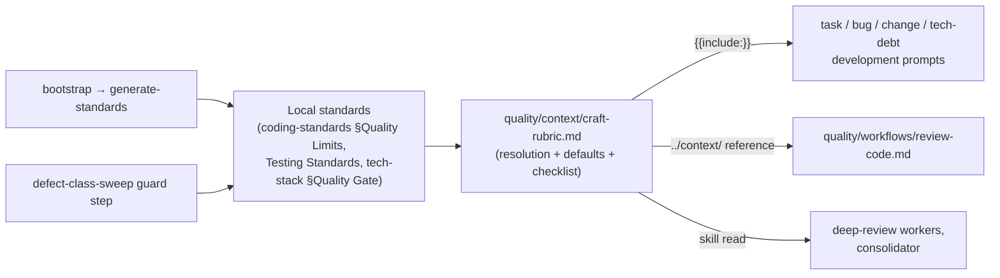

# E31-F01 Specification: Shift quality left into development

Combined requirements and architecture. `plan.md` is the working definition of
this feature, and `research-report.md` (abbreviated RR) is the validated
brownfield check. In this document, `<bundle>` means
`internal/sharkdata/default_data/`, and `<deep-review>` means
`skills/shark-rider/skills/deep-review/`.

## Traceability and upstream gaps

The parent epic has no usable PRD to cite by section. Both
`../epic.md` and `feature.md` are unfilled templates, and the epic has no
`requirements.md`, `architecture.md`, interaction map or cross-epic map.
`epic.md` frontmatter says `epic_key: E01`, but the database key is E31. This
spec records that mismatch and does not fix it.

The requirements trace to these sources instead:

| Source | Used for |
|---|---|
| E31 epic description (Shark record): "Tune the … agent/skill/command/orchestration setup … for speed and quality"; shipped code-review craft prompt and triage tail | Epic goal: fewer review rounds and higher craft quality |
| `plan.md` §Problem, §Principles 1–4, §Scope A–E, §Open decision | Feature scope |
| E31-F01 decision notes 5521 (local standards are the sole authority; open block-vs-gap decision), 5522 (generic defaults only as a fallback, defined once, labeled), 5523 (STANDARD 14/27) | Principles and constraints |
| `docs/review/bugs/b082/code-review-2026-11-19-B082-r4.md`, `…-r5.md` | Root-cause evidence: no declared threshold, and documented rules that were not loaded |
| RR Findings 1–8 | Corrections, conflicts, inventory and dependencies |

## Product critical-path guard

- unresolved prerequisite: docs/product/D01-vision-statement.md missing
- unresolved prerequisite: docs/product/D02-success-criteria.md missing
- unresolved prerequisite: docs/plan/product-delivery-roadmap.md missing
- unresolved prerequisite: docs/plan/product-critical-path.md missing

There is no current gate to name, so this guard cannot measure the
relationship to a gate or name advancement evidence. Side-quest call:
**proceed**. This is workflow-quality work on Shark's own development loop,
and the B082 rework (8 rounds) shows its value. The guard only reports.

## Capability map (from RR)

| Capability | Decision | This feature does not re-implement |
|---|---|---|
| Craft rubric in `<bundle>/skills/quality/workflows/review-code.md` | EXTEND | It moves the checklist and defaults into one shared file. It does not add a competing rubric |
| Impact-based admission in `<bundle>/skills/quality/context/review-rubric.md` (B088) | REUSE | The severity rule for generic defaults defers to it |
| Report and coverage contracts (B085) | REUSE | Report shape is unchanged |
| Gate-command source list in development prompts | REUSE | The same source list, now with an explicit empty-result rule |
| Defect-class sweep (E34-F06) | EXTEND | It adds one step: record the rule in local standards |
| Standards generator and bootstrap | EXTEND (new section) | Quality Limits is the only new concept |
| `_tdd_process` partial | EXTEND (rewrite and wire in) | It has no shipped consumer today (RR F4) |

## Requirements

All requirements are incremental. IDs are local to this feature.

### Functional requirements

#### A. Bootstrap declares the limits

| ID | Requirement | Trace |
|---|---|---|
| REQ-F-001 | `<bundle>/skills/quality/context/standards-template.md` adds the required heading `## Quality Limits` to Output A. It is a table with one row per limit: cyclomatic complexity, function length (lines), file length (lines), nesting depth, and an optional coverage target. The columns are: limit, value, applies to (production, test or both), enforcement (`tool-enforced` or `review-enforced`) and measuring command. The template's example rows may list several stacks side by side and must contain no numeric values. | plan A; note 5522 |
| REQ-F-002 | The template's `## Testing Standards (Code-Level)` must declare a test-isolation convention and an assertion-style convention. The heading entries are required; their content belongs to the project. | plan A; B082-r5/r7 |
| REQ-F-003 | `<bundle>/skills/quality/workflows/generate-standards.md`. Step 1 derives limit values from existing linter config. Step 2 writes Quality Limits and marks each row as either derived from config or proposed. When no config gives a value, the workflow proposes the generic defaults by reference to `craft-rubric.md` (REQ-F-005) and asks the user to confirm. An unattended run writes the rows with the label "proposed — confirm". Reference Configs wire each declared limit into the project's linter when that linter supports it. Step 4 fails validation when the Quality Limits section is missing. | plan A |
| REQ-F-004 | `<bundle>/skills/research/workflows/bootstrap.md`. The Phase 4 marker adds the line `**Quality Limits**: declared, not declared, or n/a (readiness 2)`. In Step 0.2 **fill-gaps** mode, when `coding-standards.md` (or a file it links as a standards sub-file) has no `## Quality Limits` heading, the run invokes generate-standards with `existing_standards_path` and adds only that section. Other sections are left unchanged. The trigger is the missing heading, not the marker value. | plan A; RR Risks (projects bootstrapped earlier) |

#### B. One rubric, resolved local-first

| ID | Requirement | Trace |
|---|---|---|
| REQ-F-005 | Create `<bundle>/skills/quality/context/craft-rubric.md`. It is the only embedded location for: (a) the limit resolution order (REQ-F-006); (b) the generic defaults: cyclomatic 10, function 50 lines, file 500 lines, nesting depth 4; (c) the source label; (d) the severity rule (REQ-F-007); (e) the craft self-review checklist, extracted from `review-code.md` Steps 2, 3, 4, 6, 7 and 8 (reuse, standards citation, SOLID and architecture, idiom, complexity and size, test design). The file names no language, linter or test framework. It contains no `{{` directives, no bare Shark CLI invocations, and no status or claim command strings. | plan B, C; note 5522; RR F6 |
| REQ-F-006 | Each limit is resolved independently, using the decision table under *Limit resolution* below. A finding or self-review line that relies on a generic default carries the label "generic default — not declared in local standards" and recommends declaring the limit through a standards refresh (bootstrap fill-gaps). | plan principle 3; note 5522 |
| REQ-F-007 | Severity rule ([Q014](#durable-unresolved-decisions), non-blocking). New or substantially expanded code over a **locally declared** limit is a blocker, because it breaks a documented standard. New code over a **generic default** is admitted only with evidenced impact, under `review-rubric.md` (B088). Code that is already over a limit and that the change does not substantially expand is a non-blocker routed to triage, whatever the limit's source. This replaces plan principle 3's "severity rules are unchanged". Today's rules contradict each other (RR F2), so they cannot all be kept. | RR F2; B088 |
| REQ-F-008 | Remove every hardcoded craft or coverage threshold outside `craft-rubric.md` and replace it with a reference to the resolved limit. The sites are in the *Component changes* table, rows B1–B9. Document-length limits are artifact rules and stay as they are; examples are the `≤50 lines` per rule example and the `< 50 lines` tiny-diff edge case. | plan B; RR F5 |
| REQ-F-009 | `<deep-review>/SKILL.md`: the reviewer-worker load instruction (about line 202) also loads `craft-rubric.md`, read with the quality skill's `context/craft-rubric.md` path, or from the extracted file. `<deep-review>/references/consolidator.md` and `angle-d-cleanup.md` apply REQ-F-007 and name no numeric threshold. | RR F2, F6 |

#### C. Development self-reviews against the same rubric

The family prompts are `<bundle>/prompts/task/development.md`,
`bug/development.md`, `change/development.md`, `tech_debt/triaged.md` and
`tech_debt/in_progress.md`.

| ID | Requirement | Trace |
|---|---|---|
| REQ-F-010 | Gate-command resolution ([Q013](#durable-unresolved-decisions), non-blocking). Check the existing gate-command sources in order. If **every** source is absent or contains only a placeholder (for example, a Quality Gate of "To be defined"), the step returns `blocked` and recommends project bootstrap. It does not implement. Missing quality **limits** never block (REQ-F-006). See *Gate-command resolution* below. | plan Open decision; note 5521; RR Risks |
| REQ-F-011 | Each family prompt's READ list explicitly loads the local standards that exist: `CLAUDE.md` and `AGENTS.md`; `docs/architecture/coding-standards.md` and the standards sub-files it links, including the Quality Limits and Testing Standards sections; `docs/architecture/patterns-catalog.md`; and the Quality Gate section of `docs/architecture/tech-stack.md`. | plan C; RR F1 (second cause) |
| REQ-F-012 | Rewrite `<bundle>/prompts/_partials/_tdd_process.md`. The template name `_tdd_process` stays. Each family prompt invokes it exactly once. Content: (a) choose verification by artifact type, using the decision table under *Verification by artifact type* below; (b) when the work item has a feature test plan, write one test per TC, with variants as separate cases. Each test name contains the TC-ID, asserts the TC's **Expected Output** exactly, and keeps the TC's Caller-Path Contract rules (entrypoint, lowest mock seam, forbidden mocks, counter-factual). Never edit a TC's Preconditions, Input or Expected Output; return `blocked` instead; (c) do not write a test that searches source text unless the searched literal is an explicit contract; (d) replace the stale `09-test-plan.md` name with "the feature test plan". | plan C; RR F4 |
| REQ-F-013 | Write within the resolved limits (REQ-F-006) on the first pass. When the project declares a measuring command, run it on the changed files before exit. | plan C |
| REQ-F-014 | Before exit, each family prompt runs the self-review checklist from `craft-rubric.md`, included with `{{include: skills/quality/context/craft-rubric.md}}`, against its own diff. It fixes every finding, or records a cited reason when an item is not applicable. | plan C |
| REQ-F-015 | Before it changes code, reopened or rework dispatch reads the latest transition note and the gate report that note cites. This sits beside the existing defect-class-sweep REWORK rule. | plan C |
| REQ-F-016 | A quality-gate failure that predates the change and sits outside the change's files is fixed when the fix is straightforward and within scope. Otherwise the worker routes a bug through the triage skill. The gate is still unmet: the task reports "not ready", and the envelope prompts return `fail`. | plan C |
| REQ-F-017 | The exit gate adds four items: (a) an evidence walk over the ACs, naming the test or check for each AC ID; (b) every new or changed function and file is within the resolved limits, and the limit's source is labeled; (c) the diff stays within the task's `## Scope` "Files to modify" list, or each extra file is justified in the summary (task only); (d) the self-review is recorded with no unresolved finding. | plan C; RR vocabulary table |
| REQ-F-018 | The completion summary begins with the line `ACs verified: <ids>; red-first: <n>/<m>; commit: <sha>`. In envelope prompts this line begins `gate_result.summary`. Plan's 175-character cap is dropped because no consumer for it exists (RR vocabulary table). | plan C |
| REQ-F-019 | `bug/development.md`, `change/development.md`, `tech_debt/triaged.md` and `tech_debt/in_progress.md` get REQ-F-010 to REQ-F-018. The bug prompt keeps its repair-plan, evidence and outcome contracts unchanged. TC rules apply only when a test plan exists. | plan C; RR F4 (tech-debt gap) |
| REQ-F-020 | The existing shortcut "existing work + gate passes → advance immediately" in `change/development.md`, `tech_debt/triaged.md` and `tech_debt/in_progress.md` also requires a passing self-review (REQ-F-014) and exit gate (REQ-F-017). | RR F4 |

#### D. Findings compound into local standards

| ID | Requirement | Trace |
|---|---|---|
| REQ-F-021 | `<bundle>/skills/quality/workflows/defect-class-sweep.md` *Guard selection*: for a craft defect class (one of the review rubric's `rule` categories), the sweep also adds or updates an entry in the project's local `coding-standards.md` (or its linked sub-file). When the project's linter supports the rule, the executable guard is that linter rule in the project's own config. A standards entry never replaces the verified guard that *Structural guard closure* requires. | plan D |

#### E. Dogfood in this repository (local, may be Go-specific)

| ID | Requirement | Trace |
|---|---|---|
| REQ-F-022 | `docs/architecture/tech-stack.md`: replace `### Quality Gate (Mandatory)` with a `## Quality Gate` table (Step, Command, When), using the shape of `<bundle>/skills/research/workflows/brownfield-analysis.md` §Quality Gate. The commands stay `make fmt`, `make lint` and `make test`. | plan E; RR F3 |
| REQ-F-023 | `docs/architecture/coding-standards.md` (the index file) adds `## Quality Limits`: cyclomatic 10, tool-enforced by gocyclo; function length 50 lines, tool-enforced by funlen with the line limit only; file length 500 lines, review-enforced; nesting depth 4, review-enforced, because nestif scores complexity, not depth. All limits apply to production and test code. The measuring command is `make lint`. `docs/architecture/coding-standards/testing.md` adds a test-isolation rule: no package-level command or flag state shared between tests (B082). The require/assert rule already exists. | plan E; RR F8 |
| REQ-F-024 | A new `.golangci-limits.yml` enables only gocyclo (min complexity 10) and funlen (lines 50, statements disabled). It is scoped by `new-from-rev`, pinned to an existing `main` commit that predates the limits config: the branch's merge-base with `main` when the task is implemented. A branch commit SHA is not used, because PRs are squash-merged and branch SHAs do not survive on `main`. `make lint` runs it after the main config. In `.github/workflows/ci.yml`, the lint job's checkout uses full history (`fetch-depth: 0`) and adds a second golangci-lint step that runs the limits config. | plan E; RR F8 |

### Non-functional requirements

| ID | Requirement | Measurement |
|---|---|---|
| REQ-NF-001 | Language neutrality: content this feature adds or changes in the embedded bundle introduces no stack-specific gate command and no numeric craft or coverage limit, except as REQ-F-005 allows. The REQ-F-001 template may show several stacks side by side. Content already in the bundle that names languages, such as `skills/debugging/SKILL.md`, is out of scope (RR F3). | Review of the diff, plus AC-02 |
| REQ-NF-002 | Single source: the generic default values appear in one embedded file only. | AC-02 |
| REQ-NF-003 | Backward compatibility: a project with no Quality Limits section, no marker field and no `patterns-catalog.md` renders every family prompt and review without error and gets labeled defaults. No migration is required. | AC-05, AC-07 |
| REQ-NF-004 | Prompt contract stability: these stay green: the existing dispatch-prompt contract tests, the guard-paragraph placement and SHA pin (re-pinned), the ban on status or claim command strings, outcome-role wording, the ban on bare Shark CLI strings in skills, and include and reference resolution. | AC-15 |
| REQ-NF-005 | Prompt size: `craft-rubric.md` stays at or under 150 lines, so the development prompt grows by a bounded amount. | Line count |
| REQ-NF-006 | Security: there are no new inputs, secrets or persistence. Prompt text must not tell workers to bypass the quality gate. | Review |

### Acceptance criteria

| AC | Given / When / Then | REQs |
|---|---|---|
| AC-01 | **Given** the embedded bundle, **when** `standards-template.md` is read, **then** Output A lists `## Quality Limits` with the five rows and five columns of REQ-F-001, and Testing Standards requires isolation and assertion-style entries. | 001, 002 |
| AC-02 | **Given** a closed, test-defined list of threshold patterns (at minimum: cyclomatic 10, function 50 lines, file 500 lines, nesting 4 or ≥4, `-over 10`, `complexity … 10`, and gate coverage percentages such as `>= 80%` or `90%+`), **when** the embedded `prompts/` and `skills/` trees and `<deep-review>/references/` are scanned, **then** matches occur only in `craft-rubric.md`. Each document-length exclusion is allowlisted by exact file and phrase. | 005, 008, NF-001, NF-002 |
| AC-03 | **Given** `generate-standards.md`, **when** it is read, **then** Steps 1, 2 and 4 contain the derive, propose, confirm and validate rules of REQ-F-003, and they reference `craft-rubric.md` instead of stating numbers. | 003 |
| AC-04 | **Given** `bootstrap.md`, **when** it is read, **then** the Phase 4 marker contains the Quality Limits line, and Step 0.2 fill-gaps names the missing-heading trigger and the section-only update. | 004 |
| AC-05 | **Given** `craft-rubric.md`, **when** it is read, **then** it contains the resolution table, the four defaults, the exact source label, the severity rule and the checklist, with no `{{`, no status or claim command string, and no bare Shark CLI invocation. It is at or under 150 lines. | 005, 006, 007, NF-005 |
| AC-06 | **Given** `review-code.md`, **when** it is read, **then** the `complexity_thresholds` input, Step 7, Step 12 and the decision rules defer to `../context/craft-rubric.md`, with no numeric thresholds, and that relative reference resolves (bundle reference test). | 008 |
| AC-07 | **Given** a rendered `task/development.md` (embedded bundle, no project overrides), **when** it is inspected, **then** it contains the rendered craft-rubric checklist and the rewritten `_tdd_process` content exactly once, with no unresolved `{{include:` or `{{template` text. | 012, 014 |
| AC-08 | **Given** the rendered task, bug, change and both tech-debt prompts, **when** they are inspected, **then** each READ list names the REQ-F-011 standards files, and each contains the REQ-F-010 empty-source rule, the REQ-F-013 limit and measuring rule, the REQ-F-015 reopen rule, the REQ-F-016 rule for failures that predate the change, and the REQ-F-018 summary line. | 010, 011, 013, 015, 016, 018, 019 |
| AC-09 | **Given** the task prompt, **when** its EXIT GATE is read, **then** it contains the four REQ-F-017 items. **Given** the bug, change and tech-debt prompts, **then** they contain items (a), (b) and (d). | 017, 019 |
| AC-10 | **Given** `change/development.md` and both tech-debt prompts, **when** the "advance immediately" condition is read, **then** it requires the quality gate, the self-review and the exit gate. | 020 |
| AC-11 | **Given** the bug prompt, **when** it is rendered, **then** its approved-plan, evidence and outcome text and its REQUIRED OUTER EVIDENCE block are unchanged apart from the inserted blocks. The outcome-role consistency test passes. | 019, NF-004 |
| AC-12 | **Given** `defect-class-sweep.md`, **when** Guard selection is read, **then** it requires a local standards entry for craft classes and states that the entry does not replace the verified guard. | 021 |
| AC-13 | **Given** `<deep-review>/SKILL.md`, `consolidator.md` and `angle-d-cleanup.md`, **when** they are read, **then** the worker load list includes `craft-rubric.md`, the blocker table applies REQ-F-007's declared-versus-default rule, and no numeric threshold remains. | 009 |
| AC-14 | **Given** this repo, **when** a new Go function longer than 50 lines, or with cyclomatic complexity over 10, is added on a branch, **then** `make lint` fails, citing funlen or gocyclo. **When** that function is removed, `make lint` passes, and it passes on unchanged `main`. | 023, 024 |
| AC-15 | `make fmt && make lint && make test` passes. That includes `internal/templates` (with the `task/development.md` baseline SHA re-pinned and the guard still a standalone paragraph after the "When done" line), `internal/sharkdata` (`TestEmbedded_SkillsContainNoBareSharkCLIRefs` and bundle references), `internal/cli/commands/next_test.go` (`TestRenderedDispatchPromptsDoNotTellWorkersToTransitionSharkState`), `gate_result_role_prompt_consistency_test.go` and `review_output_policy_test.go`. | NF-004 |
| AC-16 | **Given** `docs/architecture/tech-stack.md` and `coding-standards.md`, **when** they are read, **then** a `## Quality Gate` table and a `## Quality Limits` table exist with the REQ-F-022 and REQ-F-023 values, and `testing.md` has the isolation rule. | 022, 023 |

### Out of scope

| Item | Why |
|---|---|
| Self-routing, `amendment_pending`, and the "already complete → DONE" shortcut from the external reference prompt | Conflicts with `_resume_preamble` (plan) |
| Anchored skill includes (`SKILL.md#Section`) | Needs a resolver change in `internal/templates`. File it separately as tech debt (plan) |
| Removing language names from existing bundle content (`skills/debugging/SKILL.md`, the language examples in `review-code.md`) | Already there before this feature. REQ-NF-001 is narrowed accordingly (RR F3) |
| Changing errcheck's `Close` exclusions or its test-file exclusion in `.golangci.yml` | Would break the baseline. Ignoring close errors stays review-enforced under coding-standards Error Handling. This is a known gap (RR F8) |
| Pinning the CI golangci-lint version (`version: latest`, while `make lint` pins v2.9.0) | Already the case and unrelated. Noted as a risk |
| Changing the report shape or coverage contract (B085) | Reused as-is |
| Linter enforcement of growth inside existing functions | `new-from-rev` reports funlen and gocyclo on the function declaration line, so an existing function that grows is not flagged. This stays review-enforced |
| CC-047 (mandatory dev quality gate) and CC-044 | CC-047 is covered by REQ-F-010, REQ-F-011 and REQ-F-019. Recommendation: close it as covered by E31-F01 once this feature completes (parent or owner follow-up; this step does not edit it). CC-044 stays separate |

## Architecture

### Component changes

| # | File | Change |
|---|---|---|
| A1 | `<bundle>/skills/quality/context/standards-template.md` | Add the `## Quality Limits` heading and table spec; add required Testing Standards entries (REQ-F-001, REQ-F-002) |
| A2 | `<bundle>/skills/quality/workflows/generate-standards.md` | Add Quality Limits to the Output A list and to Steps 1, 2 and 4; add the Reference Configs wiring (REQ-F-003) |
| A3 | `<bundle>/skills/research/workflows/bootstrap.md` | Add the Phase 4 marker line and the Step 0.2 fill-gaps trigger (REQ-F-004) |
| B1 | `<bundle>/skills/quality/context/craft-rubric.md` | **New** (REQ-F-005 to REQ-F-007) |
| B2 | `<bundle>/skills/quality/workflows/review-code.md` | `complexity_thresholds` input text, Step 6 and 7 pointer, Step 12 Blocker row, decision rules; reference `../context/craft-rubric.md` (REQ-F-008) |
| B3 | `<bundle>/skills/quality/context/code-review-reference.md` | Threshold literals in example commands become placeholders for the resolved limit |
| B4 | `<bundle>/skills/implementation/context/coding-standards.md` (about line 259) | "< 50 lines" becomes "within the resolved function-length limit (craft rubric)" |
| B5 | `<bundle>/skills/implementation/context/validation-gates.md` (about lines 241–251 and 516), `testing-requirements.md` (about lines 29–30 and 473) | Fixed coverage percentages become the project's declared coverage target, when one is declared |
| B6 | `<bundle>/skills/implementation/workflows/implement-backend.md` (about lines 492 and 608), `implement-api.md` (about lines 506 and 529), `implement-tests.md` (about lines 665 and 686) | Same as B5 |
| B7 | `<deep-review>/SKILL.md` (about line 202) | Load `craft-rubric.md` (REQ-F-009) |
| B8 | `<deep-review>/references/consolidator.md` (about line 63) | Blocker row applies REQ-F-007 |
| B9 | `<deep-review>/references/angle-d-cleanup.md` (about lines 35–45) | Threshold placeholders; defer to the craft rubric |
| C1 | `<bundle>/prompts/_partials/_tdd_process.md` | Rewrite (REQ-F-012) |
| C2 | `<bundle>/prompts/task/development.md` | READ list, gate-command rule, `_tdd_process`, limits, self-review include, reopen rule, rule for failures that predate the change, exit gate, summary line (REQ-F-010 to REQ-F-018) |
| C3 | `<bundle>/prompts/bug/development.md`, `change/development.md`, `tech_debt/triaged.md`, `tech_debt/in_progress.md` | Same blocks as C2, plus the shortcut condition change (REQ-F-019, REQ-F-020) |
| D1 | `<bundle>/skills/quality/workflows/defect-class-sweep.md` | Guard selection paragraph (REQ-F-021) |
| E1 | `docs/architecture/tech-stack.md`, `docs/architecture/coding-standards.md`, `docs/architecture/coding-standards/testing.md` | REQ-F-022, REQ-F-023 |
| E2 | `.golangci-limits.yml` (new), `Makefile` (`lint` target), `.github/workflows/ci.yml` (lint job) | REQ-F-024 |
| T1 | `internal/templates/includes_test.go` | Re-pin the `task/development.md` hash in `productCriticalPathGuardBaselineSHA256`. The guard stays a standalone paragraph after the "When done" line |
| T2 | `internal/templates/partials_test.go`, `orchestrator_partials_test.go` | Update the `_tdd_process` expectations to the new content. `task_execution_templates_test.go` defines its own fixture partial and needs no change |
| T3 | New test in `internal/sharkdata/` (beside `embed_test.go`) | AC-02 threshold scan; AC-05 craft-rubric checks; AC-07 and AC-08 rendered-prompt checks |

There is no Go production code change. Any project with a
`shark-data/overrides/` copy of a changed prompt or skill hides the update
(RR F7). This repo has no overrides and uses the embedded bundle.

### Data model

No database schema, migration or persisted field. There are two new document
shapes: the `## Quality Limits` table (REQ-F-001) and the marker line
(REQ-F-004). The marker value is descriptive only, because the fill-gaps
trigger reads the heading. So **no behavior-bearing lifecycle field is
added**, and no closed lifecycle table is required.

### Interface contracts

**Limit resolution** (one row per limit, evaluated independently):

| Local Quality Limits row for this limit | Value used | Source label | Severity when new code exceeds it |
|---|---|---|---|
| Present with a value (in `coding-standards.md` or a linked sub-file) | Local value | "declared in local standards (§Quality Limits)" | Blocker |
| Present but marked "proposed — confirm" | Local value | "proposed in local standards, unconfirmed" | Same as a generic default |
| Absent, or the section is missing | Generic default from `craft-rubric.md` | "generic default — not declared in local standards" | Admitted only with evidenced impact (B088) |

Code that is already over a limit and that the change did not substantially
expand is a non-blocker routed to triage in every row.

**Gate-command resolution** (development prompts):

| Sources checked in order: `CLAUDE.md`, `AGENTS.md`, `tech-stack.md` Quality Gate, `coding-standards.md`, `test-gate.md`, documented build or task targets | Outcome |
|---|---|
| At least one source names runnable commands | Run them; all must pass |
| All sources are absent or contain placeholders only ("To be defined", template braces) | `blocked`; recommend project bootstrap; no implementation |

**Verification by artifact type** (`_tdd_process`):

| Change type | Verification |
|---|---|
| Behavior-changing code | Red first: the failing test is observed before implementation |
| Refactor with no behavior change | Existing tests are green before and after; no new red step is required |
| Prompt, documentation or configuration | The test plan's planned check for the TC (render, include resolution, validator); a source-text search only when the literal is an explicit contract |

### Key technical decisions

| # | Decision | Rationale and pattern |
|---|---|---|
| D1 | Put the shared rubric in a skill context file. Use `{{include:}}` from prompts and a relative path from `review-code.md`; do not use a `{{template}}` partial | `shark skill get` resolves includes but not templates (`internal/services/content_bundle_service.go` about lines 142–149; RR F6). This follows how `review-code.md` already references `../context/code-review-reference.md` |
| D2 | Rewrite `_tdd_process` and wire it in, instead of deleting it | Reuses an existing partial and its tests. Development prompts already use `{{template}}` partials (`_resume_preamble`). It ends a partial that had no consumer (RR F4) |
| D3 | Severity: a declared limit may block; a default needs evidenced impact (Q014) | Follows B088 (the newer, merged contract) and `review-code.md`'s rule "do not invent standards". It deliberately departs from plan principle 3 because the current rules contradict each other |
| D4 | Block only when every gate source is empty (Q013) | Matches the owner's proposal in note 5521. Running the full source chain first keeps the other fallbacks working; treating a placeholder as empty covers greenfield readiness 2 |
| D5 | Tech-debt prompts are in scope, and the shortcuts are tightened | Same defect class (RR F4). A shortcut that skips self-review would undo the feature |
| D6 | Dogfood with a separate limits config, `new-from-rev` pinned to a SHA, and CI full history | Applying plain thresholds breaks the lint gate (RR F8 baseline). A separate config leaves the standard linters' full-repo scope unchanged. A fixed `main` SHA that predates the config survives squash merges. Unlike a moving merge-base with `main`, it works on `main` and on branches: every line merged after it is checked. Shallow CI checkouts lack the SHA, so `fetch-depth: 0` is required |
| D7 | Nesting depth and file length are review-enforced in this repo | No configured golangci linter measures depth (nestif scores complexity) or file length |
| D8 | Drop the 175-character summary cap | No consumer exists (RR vocabulary table). The line format is kept |

### Integration and dependency discovery

This follows `<bundle>/skills/quality/workflows/state-space-coverage.md`
§Dependency discovery. There is one line per source.

1. **I-##/X-## rows:** none. E31 has no interaction map or cross-epic map, and
   `docs/product/cross-epic-integration-map.md` has no E31 row. *Excluded.*
2. **Production caller paths:** the dispatch render (`shark next` → the
   orchestrator renderer in `internal/templates` → prompts, resolving
   `{{template}}` and `{{include:}}`); skill reads (`shark skill get` →
   `content_bundle_service.go`); and host deep-review workers reading the
   quality skill. *Included:* AC-07, AC-08 and AC-13 exercise them.
3. **Persistence readers:** nothing persisted. The bootstrap marker file is
   read by bootstrap Step 0.2 and by
   `<bundle>/skills/product-design/workflows/d04-feasibility.md`. The added
   line is additive and descriptive. *Included as read-compatible.*
4. **Dedup or short-circuit logic:** the "advance immediately" shortcuts in
   the change and tech-debt prompts, and `_resume_preamble`. *Included:*
   REQ-F-020. `_resume_preamble` is unchanged because it already requires the
   evidence for each phase.
5. **Prior spec obligations:** E34-F10 guard placement and SHA pin
   (`includes_test.go` TC-002 and TC-003), CC-044 development-prompt edits,
   B066 triage routing (`embed_test.go` `TestEmbedded_ReviewFindingsRouteThroughTriage`,
   `review_output_policy_test.go`), B085 report shape, and B088 admission.
   *Included:* T1 and AC-15. Wording edits must keep "triage skill's decision
   tree" in `review-code.md`.

## Cross-feature interactions

None. E31 has a single feature (E31-F01) and no `E31-interaction-map.md`, so
no I-## is produced or consumed.

## Cross-epic integrations

None. No `E31-cross-epic-map.md` exists, and
`docs/product/cross-epic-integration-map.md` contains no E31 row. Shared skill
consumers (deep review, defect-class sweep) are internal bundle consumers,
covered in *Integration and dependency discovery*.

## Durable unresolved decisions

| Question | Decision | Spec default | Blocking |
|---|---|---|---|
| Q013 | Block or proceed when no gate commands are declared | `blocked`, only after every source is empty (REQ-F-010) | No. Answering "proceed" changes REQ-F-010 and AC-08 only |
| Q014 | Does a declared limit alone block, with defaults impact-gated? | Yes (REQ-F-007) | No. Another answer changes REQ-F-007, B2, B8 and AC-13 only |

Decisions not material enough for a Question, with rationale: tech-debt scope
(D5); `_tdd_process` wiring (D2); dropping the 175-character cap (D8); the
dogfood baseline mechanism (D6); and CC-047 disposition (Out of scope).

## Sizing and task split

The feature is **L**. Task generation must produce tasks of size M or smaller.
The suggested split follows plan §Sizing with one change: task 2 (B) runs
before task 3 (C), because C includes the file that B creates.

| # | Scope | Size |
|---|---|---|
| 1 | A1–A3 | M |
| 2 | B1–B9, AC-02 scan test | M |
| 3 | C1, C2, T1, T2 | M |
| 4 | C3 | S |
| 5 | D1 | XS |
| 6 | E1, E2 | S |

## Risks

- The CI golangci-lint version is `latest` while `make lint` pins v2.9.0, so
  funlen or gocyclo results may differ. AC-14 is checked locally, and the CI
  lint job must pass on the PR.
- A project override (`shark-data/overrides/`) of a changed file hides the
  update. That is the existing behavior.
- Questions Q013 and Q014 may be answered differently from the spec defaults.
  Each answer has a bounded blast radius, listed above.

## Amendment 1 (2026-11-27): owner decisions after code review round 1

Source: `docs/review/E31-claude-workflow-optimization/E31-F01-shift-quality-left-into-development/code-review-20261127T1244-E31-F01.md`
(candidate `966333ea`). This amendment overrides any conflicting text above.

1. **Edited files are cleaned up (F-4; changes REQ-F-007 and REQ-F-017(b), supersedes F-12).**
   Owner: "If you edited a file and it is over the limits, then you refactor to fix it (or
   consult the architect to see if it is safe, but in general that is good maintenance
   practice). If it is messy, you clean it up. Refactor mercilessly."
   - The development exit gate stays strict: a file the change edits ends within the
     resolved limits, including overages that existed before the change.
   - When the safety of a refactor is in doubt, the worker consults the architect. A
     recorded architect decision not to refactor is the only exception.
   - Code review severity must not contradict this gate. The specification step defines
     the reconciled severity rule (keeping the Q014 distinction between declared limits and
     generic defaults where it does not conflict with the owner statement), how the
     consultation and exception are recorded, and how the rule applies to this branch.
2. **Tech-debt blocked loop is fixed here (F-1).** A tech-debt development step that
   returns `blocked` must not be auto-redispatched to the developer.
3. **Cheap review findings are fixed here:** F-2, F-3/F-6, F-5, F-7, F-8, F-9, F-10, F-11,
   F-14, F-15, F-16/F-18, F-17, F-19 (descriptions and fix sketches are in the report).
4. **Deferred:** F-13 (quality blocks copied into five prompts) becomes a follow-up item,
   unless the reconciled design makes a shared partial the cheaper way to apply item 1.
