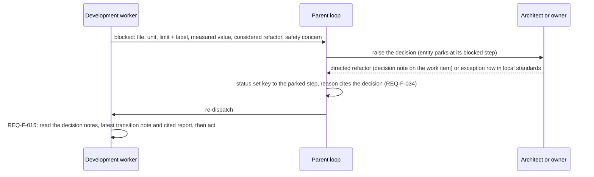
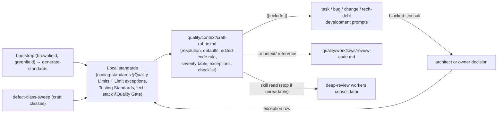

# E31-F01 Specification: Shift quality left into development

Combined requirements and architecture. `plan.md` is the working definition of
this feature, and `research-report.md` (abbreviated RR) is the validated
brownfield check. In this document, `<bundle>` means
`internal/sharkdata/default_data/`, and `<deep-review>` means
`skills/shark-rider/skills/deep-review/`.

This revision integrates the owner decisions taken after code review round 1
(candidate `966333ea`) and round 2 (candidate `5d848cab`). The body below is
authoritative; the [change log](#change-log) lists what changed and why.
Code-review finding IDs F-1 … F-19 refer to the round-1 report; F-101 … F-115,
G-1 and G-2 refer to the round-2 report
(`docs/review/E31-claude-workflow-optimization/E31-F01-shift-quality-left-into-development/code-review-20261127T1627-E31-F01.md`).
Both reports sit in the git-ignored `docs/review/` tree, so this spec restates
every fix it adopts and does not depend on the reports being present. Rows and
requirements changed by round 2 are marked **R2**.

## Traceability and upstream gaps

The parent epic has no usable PRD to cite by section. Both
`../epic.md` and `feature.md` are unfilled templates, and the epic has no
`requirements.md`, `architecture.md`, interaction map or cross-epic map.
`epic.md` frontmatter says `epic_key: E01`, but the database key is E31. This
spec records that mismatch and does not fix it.

The requirements trace to these sources instead:

| Source | Used for |
|---|---|
| E31 epic description (Shark record): "Tune the … agent/skill/command/orchestration setup … for speed and quality"; shipped code-review craft prompt and triage tail | Epic goal: fewer review rounds and higher craft quality |
| `plan.md` §Problem, §Principles 1–4, §Scope A–E, §Open decision | Feature scope |
| E31-F01 decision notes 5521 (local standards are the sole authority; open block-vs-gap decision), 5522 (generic defaults only as a fallback, defined once, labeled), 5523 (STANDARD 14/27), 5527 (owner answers to Q013 and Q014) | Principles and constraints |
| Owner decisions after code review round 1 (recorded in commit `0afee8b5`, now folded into this body; quoted under *Edited-code rule*) | Edited-code rule, tech-debt blocked loop, round-1 fixes in scope, F-13 deferral |
| Owner decisions after code review round 2 (note 5566; amendment note 5568; follow-ups note 5567) | Round-2 fixes in scope, Go-only limit scope in this repo, resume wording, B091/B092/TD-242 split-out |
| `docs/review/bugs/b082/code-review-2026-11-19-B082-r4.md`, `…-r5.md` | Root-cause evidence: no declared threshold, and documented rules that were not loaded |
| RR Findings 1–8 | Corrections, conflicts, inventory and dependencies |

## Product critical-path guard

- unresolved prerequisite: docs/product/D01-vision-statement.md missing
- unresolved prerequisite: docs/product/D02-success-criteria.md missing
- unresolved prerequisite: docs/plan/product-delivery-roadmap.md missing
- unresolved prerequisite: docs/plan/product-critical-path.md missing

There is no current gate to name, so this guard cannot measure the
relationship to a gate or name advancement evidence. Side-quest call:
**proceed**. This is workflow-quality work on Shark's own development loop,
and the B082 rework (8 rounds) shows its value. The guard only reports.

## Capability map (from RR)

| Capability | Decision | This feature does not re-implement |
|---|---|---|
| Craft rubric in `<bundle>/skills/quality/workflows/review-code.md` | EXTEND | It moves the checklist and defaults into one shared file. It does not add a competing rubric |
| Impact-based admission in `<bundle>/skills/quality/context/review-rubric.md` (B088) | REUSE | Unchanged. The craft rubric states how its findings meet these admission criteria |
| Report and coverage contracts (B085) | REUSE | Report shape is unchanged |
| Gate-command source list in development prompts | REUSE | The same source list, now with an explicit empty-result rule |
| Defect-class sweep (E34-F06) | EXTEND | It adds one step: record the rule in local standards |
| Standards generator and bootstrap | EXTEND (new section) | Quality Limits is the only new concept |
| `_tdd_process` partial | EXTEND (rewrite and wire in) | It had no shipped consumer before this feature (RR F4) |
| Parking step (`action: pause`, `parking: true`) in `<bundle>/workflow/bug.yaml`, `change.yaml`, `task.yaml` | REUSE for tech debt | No new engine behavior. **R2:** the engine does not compute the resume target from history. `internal/config/workflow/steps.go` (about lines 429–433) lists every workable step as a parking step's transition target, so `status set <key> <parked step>` resumes, while a plain `status advance` takes the first sorted target (B091, not fixed here) |
| Outer envelope `evidence[]` (`internal/workercontrol/envelope.go`, `EvidenceRef`: up to 100 entries, 1000-byte summary each) | REUSE | No new result field |
| golangci-lint `--whole-files` with `new-from-rev` (v2.9.0) | REUSE | No custom measuring script |

## Requirements

All requirements are incremental. IDs are local to this feature. IDs are
stable across revisions; requirements added by the round-1 decisions start at
REQ-F-025 (REQ-F-028 is unused), and those added by round 2 start at REQ-F-034.

### Functional requirements

#### A. Bootstrap declares the limits

| ID | Requirement | Trace |
|---|---|---|
| REQ-F-001 | `<bundle>/skills/quality/context/standards-template.md` adds the required heading `## Quality Limits` to Output A. It is a table with one row per limit: cyclomatic complexity, function length (lines), file length (lines), nesting depth, and an optional coverage target. The columns are: limit, value, applies to (production, test or both), enforcement (`tool-enforced` or `review-enforced`) and measuring command. The template's example rows may list several stacks side by side and must contain no numeric values. The section also defines the optional `### Limit exceptions` table of REQ-F-025. | plan A; note 5522; owner decision 1 |
| REQ-F-002 | The template's `## Testing Standards (Code-Level)` must declare a test-isolation convention and an assertion-style convention. The heading entries are required; their content belongs to the project. | plan A; B082-r5/r7 |
| REQ-F-003 | `<bundle>/skills/quality/workflows/generate-standards.md`. Step 1 derives limit values from existing linter config. Step 2 writes Quality Limits and marks each row as either derived from config or proposed. When no config gives a value, the workflow proposes the generic defaults by reference to `craft-rubric.md` (REQ-F-005) and asks the user to confirm. An unattended run writes the rows with the label "proposed — confirm". Reference Configs wire each declared limit into the project's linter when that linter supports it. Step 4 fails validation when the Quality Limits section is missing. | plan A |
| REQ-F-004 | `<bundle>/skills/research/workflows/bootstrap.md`. The Phase 4 marker adds the line `**Quality Limits**: declared, not declared, or n/a (readiness 2)`. In Step 0.2 **fill-gaps** mode, when `coding-standards.md` (or a file it links as a standards sub-file) has no `## Quality Limits` heading, the run invokes generate-standards with `existing_standards_path` and adds only that section. Other sections are left unchanged. The trigger is the missing heading, not the marker value. A present section with a missing or placeholder row is not a fill-gaps trigger; REQ-F-006 names the remedy for that case. | plan A; RR Risks; F-9 |
| REQ-F-030 | `bootstrap.md` **Greenfield** standards generation follows `standards-template.md` Output A, so it writes the `## Quality Limits` section (values proposed from the generic defaults by reference to `craft-rubric.md`, labeled "proposed — confirm") and the REQ-F-002 Testing Standards entries. | plan A; F-8 |

#### B. One rubric, resolved local-first

| ID | Requirement | Trace |
|---|---|---|
| REQ-F-005 | `<bundle>/skills/quality/context/craft-rubric.md` is the only embedded location for: (a) the limit resolution order (REQ-F-006); (b) the generic defaults: cyclomatic 10, function 50 lines, file 500 lines, nesting depth 4; (c) the source label; (d) the edited-code rule and severity table (REQ-F-007); (e) the limit-exception rule (REQ-F-025) and the architect consultation (REQ-F-026); (f) the craft self-review checklist, extracted from `review-code.md` Steps 2, 3, 4, 6, 7 and 8 (reuse, standards citation, SOLID and architecture, idiom, complexity and size, test design). The file names no language, linter or test framework. It contains no `{{` directives, no bare Shark CLI invocations, and no status or claim command strings. | plan B, C; note 5522; RR F6 |
| REQ-F-006 | Each limit is resolved independently, using the decision table under *Limit resolution* below. A finding or self-review line that relies on a generic default carries the label "generic default — not declared in local standards" and recommends declaring the limit: add or fill that row in the local `## Quality Limits` table, or run bootstrap fill-gaps when the whole section is missing. | plan principle 3; note 5522; F-9 |
| REQ-F-007 | **Edited-code rule and severity** (replaces the round-1 "substantially expanded" and "already over → triage" rules). Every code file the change edits ends within every resolved limit: its file length and every function in it, including overages that existed before the change. Exactly one exception exists: a limit exception that covers the unit (REQ-F-025). Code review applies the closed *Severity table* below, which gives the same verdict as the development exit gate for every edited file. The Q014 distinction (a declared limit blocks; a generic default needs evidenced impact) survives only for files the change did not edit. | owner decision 1; Q014 (note 5527); F-4, F-12 |
| REQ-F-025 | **Limit exceptions.** An exception is a row in the optional `### Limit exceptions` table under the local `## Quality Limits` section, with the columns and rules under *Limit exceptions* below: it covers only a unit that existed before the change, only while the unit's measurement is at or below the recorded value, and only an architect or owner decision adds or changes it. Where a tool enforces the limit, the unit also carries the tool's own suppression citing the row. | owner decision 1 |
| REQ-F-008 | Remove every hardcoded craft or coverage threshold outside `craft-rubric.md` and replace it with a reference to the resolved limit. The sites are in the *Component changes* table, rows B1–B9. Document-length limits are artifact rules and stay as they are; examples are the `≤50 lines` per rule example and the `< 50 lines` tiny-diff edge case. | plan B; RR F5 |
| REQ-F-009 | `<deep-review>/SKILL.md`: the reviewer-worker load instruction (about line 204) also loads `craft-rubric.md`, read with the quality skill's `context/craft-rubric.md` path, or from the extracted file. Before any runner dispatches a reviewer, the host confirms the rubric is readable by either route. When it is not (for example, an installed Shark binary older than this feature), the host stops the review, reports it incomplete and names the missing rubric. It does not review without the rubric. **R2 (G-1):** the Runner 3 (alternate or comparable-model CLI) prompt contents also name `craft-rubric.md` and its two read routes, so a fallback reviewer grades with the rubric. `<deep-review>/references/consolidator.md`, `angle-d-cleanup.md` and `<bundle>/skills/quality/workflows/review-code.md` apply the REQ-F-007 severity table by reference and name no numeric threshold and no "substantially expanded" rule. | RR F2, F6; F-5; G-1; owner decision 1 |
| REQ-F-029 | `craft-rubric.md` cites the admission criteria as `../context/review-rubric.md`. That relative form makes the renderer add its bundled-skill read note when the rubric is inlined into a prompt (`internal/templates/includes.go` `bundledSkillNote` and `skillRelativePathPattern`), so a zero-config install can open the file. | F-11 |
| REQ-F-035 | **R2 (F-110).** `craft-rubric.md` *Scope of the limits* adds: when the local `## Quality Limits` section states, in a sentence, that the limits apply only to named languages, code files in other languages are not measured; when they name none, every code file is. A file outside a declared language scope is therefore not a "limit not declared" case and never falls back to a generic default. The consultation bullet's re-dispatch sentence names the work item's decision notes (REQ-F-015). | F-110; F-102; note 5566 |

#### C. Development self-reviews against the same rubric

The family prompts are `<bundle>/prompts/task/development.md`,
`bug/development.md`, `change/development.md`, `tech_debt/triaged.md` and
`tech_debt/in_progress.md`.

| ID | Requirement | Trace |
|---|---|---|
| REQ-F-010 | Gate-command resolution (Q013, answered `blocked` in note 5527). Check the existing gate-command sources in order. If **every** source is absent or contains only a placeholder (for example, a Quality Gate of "To be defined"), the step returns `blocked` and recommends project bootstrap. It does not implement. Missing quality **limits** never block (REQ-F-006). See *Gate-command resolution* below. | plan Open decision; notes 5521, 5527 |
| REQ-F-011 | Each family prompt's READ list explicitly loads the local standards that exist: `CLAUDE.md` and `AGENTS.md`; `docs/architecture/coding-standards.md` and the standards sub-files it links, including the Quality Limits (with Limit exceptions) and Testing Standards sections; `docs/architecture/patterns-catalog.md`; and the Quality Gate section of `docs/architecture/tech-stack.md`. Each file appears once in the READ list; the bug prompt drops its older separate `CLAUDE.md for coding standards and test patterns` item. | plan C; RR F1; F-15 |
| REQ-F-012 | Rewrite `<bundle>/prompts/_partials/_tdd_process.md`. The template name `_tdd_process` stays. Each family prompt invokes it exactly once. Content: (a) choose verification by artifact type, using the decision table under *Verification by artifact type* below. The table overrides red-first wording in **any** included skill; the partial does not claim that the prompt includes a skill; (b) when the work item has a feature test plan, write one test per TC **assigned to this work item**, with variants as separate cases. Each test name contains the TC-ID, asserts the TC's **Expected Output** exactly, and keeps the TC's Caller-Path Contract rules (entrypoint, lowest mock seam, forbidden mocks, counter-factual). Never edit a TC's Preconditions, Input or Expected Output; return `blocked` instead; (c) do not write a test that searches source text unless the searched literal is an explicit contract; (d) say "the feature test plan", not the stale `09-test-plan.md`. | plan C; RR F4; F-3/F-6, F-14 |
| REQ-F-013 | Write within the resolved limits on the first pass, and apply the edited-code rule (REQ-F-007) to every code file the change edits. Measure each edited code file **in full**, not only the changed lines. When the project declares a measuring command, run it so it covers every edited code file in full; when that command measures only new code, measure the rest of each edited file by tool or by hand. | plan C; owner decision 1 |
| REQ-F-014 | Before exit, each family prompt runs the self-review checklist from `craft-rubric.md`, included with `{{include: skills/quality/context/craft-rubric.md}}`, against its own diff. It fixes every finding, or records a cited reason when an item is not applicable. | plan C |
| REQ-F-015 | Before it changes code, reopened or rework dispatch reads the latest transition note, the gate report that note cites, and **(R2, F-102)** the work item's decision notes. This sits beside the existing defect-class-sweep REWORK rule. It is how a worker re-dispatched after an architect consultation (REQ-F-026) picks up the decision, which is recorded as a decision note and is not part of the rendered prompt. The instruction lives in each family prompt's REOPENED line (D14); `craft-rubric.md`'s consultation bullet says the same in place. | plan C; owner decision 1; F-102 |
| REQ-F-016 | A quality-gate failure that predates the change and sits outside the change's files is fixed when the fix is straightforward and within scope. Otherwise the worker routes a bug through the triage skill. The gate is still unmet: the task reports "not ready", and the envelope prompts return `fail`. A limit overage inside an **edited** file is not this case; REQ-F-007 governs it. | plan C; owner decision 1 |
| REQ-F-017 | The exit gate adds four items: (a) an evidence walk over the ACs, naming the test or check for each AC ID; (b) every code file the change edits is within the resolved limits (file length and every function in it, including overages that existed before the change), measured in full, with each limit's source label stated; any unit still over a limit names the limit exception that covers it; (c) the diff stays within the task's `## Scope` "Files to modify" list, or each extra file is justified in the summary (task only; files created by a limit refactor are justified this way); (d) the self-review is recorded with no unresolved finding. | plan C; owner decision 1; F-4 |
| REQ-F-018 | The completion summary begins with the line `ACs verified: <ids>; red-first: <n>/<m>; commit: <sha>`. In envelope prompts this line begins `gate_result.summary`. Plan's 175-character cap is dropped because no consumer for it exists (RR vocabulary table). In `change/development.md`, both tech-debt prompts and **(R2, F-103)** `bug/development.md`, the per-AC evidence walk, the limit source labels and the self-review record go in outer `evidence[]` entries (one entry per AC or record: `kind`, `pointer` to the test, check or file, and a `summary`), so `gate_result.summary` holds only the line above and the verdict and stays within its 1000-byte cap. In the bug prompt these entries use the kinds `ac_evidence`, `limit_measurement` and `self_review`, sit alongside the entries its REQUIRED OUTER EVIDENCE block requires, and never reuse a runner-reserved kind (`plan_review_report` or any kind beginning `bug_`; `internal/runner/bug_candidate_admission.go` `selectBugEvidence` requires exactly one entry per reserved kind). The routing sentence sits outside that block and does not contain the text `"evidence": [`, because `TestRenderedPromptLint` reads the last such example as the required-kinds list. | plan C; F-2; F-103 |
| REQ-F-019 | `bug/development.md`, `change/development.md`, `tech_debt/triaged.md` and `tech_debt/in_progress.md` get REQ-F-010 to REQ-F-018 and REQ-F-026 to REQ-F-027. **R2 (F-103, G-2):** the bug prompt keeps its repair-plan, decision-constraint, `route_rework` role line, `_gate_result_directive` and REQUIRED OUTER EVIDENCE contracts unchanged, with two permitted edits: (a) the REQ-F-018 evidence routing, including the EXIT GATE evidence-walk item, which now points at outer `evidence[]`; (b) the DECISION sentence's `blocked` clause widens from "unavailable external evidence" to also cover a missing quality gate (REQ-F-010), an architect consultation (REQ-F-026) and unclear requirements, so a worker never picks `fail` (which routes back to development) for those cases. All other DECISION outcomes keep their wording. TC rules apply only when a test plan exists. | plan C; RR F4; F-103; G-2 |
| REQ-F-020 | The existing shortcut "existing work + gate passes → advance immediately" in `change/development.md`, `tech_debt/triaged.md` and `tech_debt/in_progress.md` also requires a passing self-review (REQ-F-014) and exit gate (REQ-F-017). | RR F4 |
| REQ-F-026 | **Architect consultation.** When the worker doubts that a refactor required by REQ-F-007 is safe, it does not leave the overage in place, and it does not record an exception itself. It returns `blocked` and names the file, the unit, the limit and its source label, the measured value, the refactor it considered and the safety concern. In envelope prompts this text goes in `gate_result.no_kickback_reason`. The architect (or the owner) decides. The decision is either a directed refactor, recorded as a decision note on the work item, or a limit exception (REQ-F-025). The re-dispatched worker reads it under REQ-F-015. | owner decision 1 |
| REQ-F-027 | The PRECEDENCE line in all five prompts keeps "preserve the code and history" for existing or resumed code, and requires "tests that fail without it" only for **behavior-changing** code. Refactors and prompt, documentation or configuration changes follow the `_tdd_process` verification table. | F-10 |

#### D. Findings compound into local standards

| ID | Requirement | Trace |
|---|---|---|
| REQ-F-021 | `<bundle>/skills/quality/workflows/defect-class-sweep.md` *Guard selection*: for a **craft** defect class, the sweep also adds or updates an entry in the project's local `coding-standards.md` (or its linked sub-file). The craft classes are these `review-code.md` §B rule categories: `ALTITUDE`, `CODING-STANDARD`, `COMPLEXITY`, `DIP`, `DRY`, `ERROR-HANDLING`, `IDIOM`, `ISP`, `LOGGING`, `LSP`, `NAMING`, `OCP`, `SIMPLIFICATION`, `SRP`, `TESTS`, `TYPES`, `YAGNI`. The other categories (`ARCH`, `ARCHITECTURE`, `CONTRACT`, `CORRECTNESS`, `REMOVED-BEHAVIOR`, `RISK`, `ROUNDTRIP`, `SECURITY`, `SIBLING`, `WIRING`) are not craft classes and never edit standards. A **new** entry is labeled "proposed — confirm" unless the owner confirms it in the same session. When the project's linter supports the rule, the executable guard is that linter rule in the project's own config. A standards entry never replaces the verified guard that *Structural guard closure* requires. | plan D; F-7 |

#### E. Workflow: tech-debt blocked parks instead of looping

| ID | Requirement | Trace |
|---|---|---|
| REQ-F-031 | `<bundle>/workflow/tech-debt.yaml` adds a `blocked` parking step that mirrors the `blocked` step in `change.yaml`: phase `blocked`, color red, display token `BLK`, responsibility human, `action: pause`, `parking: true`, prompt `tech_debt/blocked.md`. The `blocked` outcome of `identified`, `research`, `triaged` and `in_progress` routes to `blocked` instead of `identified`. No `rework_outcomes` is added (bug and change parking steps have none). New prompt `<bundle>/prompts/tech_debt/blocked.md` mirrors `prompts/change/blocked.md`. See the closed table under *Tech-debt status lifecycle*. | owner decision 2; F-1 |
| REQ-F-034 | **R2 (F-101, G-11).** `<bundle>/prompts/change/blocked.md`, `bug/blocked.md` and `tech_debt/blocked.md` no longer tell the reader to resume with a plain status advance. Their last line is replaced by two lines: find the step the item was parked from with `shark status history {{.id}}`, then resume that step with `shark status set {{.id}} <parked step> --reason "<the decision or resolution>"`. No `--force` is needed, because a parking step lists every workable step as a transition target. The three prompts stay identical apart from the entity noun (the TC-020f mirror test). `task/blocked.md` is unchanged (a task's plain advance returned to `development` in the round-2 probe). The engine's plain-advance behavior is B091 and is not changed here (REQ-NF-007). | F-101; G-11; note 5567 |

#### F. Dogfood in this repository (local, may be Go-specific)

| ID | Requirement | Trace |
|---|---|---|
| REQ-F-022 | `docs/architecture/tech-stack.md`: replace `### Quality Gate (Mandatory)` with a `## Quality Gate` table (Step, Command, When), using the shape of `<bundle>/skills/research/workflows/brownfield-analysis.md` §Quality Gate. The commands stay `make fmt`, `make lint` and `make test`. | plan E; RR F3 |
| REQ-F-023 | `docs/architecture/coding-standards.md` (the index file) adds `## Quality Limits`: cyclomatic 10, tool-enforced by gocyclo; function length 50 lines, tool-enforced by funlen with the line limit only; file length 500 lines, review-enforced; nesting depth 4, review-enforced, because nestif scores complexity, not depth. All limits apply to production and test code. **R2 (F-110):** a sentence under the table states that the limits apply to Go source only; other languages in this repo (for example `review_workflow.js`) are not measured. The `Applies to` cells stay `production and test`. The measuring command is `make lint`. The section states that `make lint` measures every function in each Go file changed since the pinned revision (REQ-F-024), and that file length and nesting depth are checked on every edited file by self-review and code review. `docs/architecture/coding-standards/testing.md` adds a test-isolation rule: no package-level command or flag state shared between tests (B082). The require/assert rule already exists. | plan E; RR F8; owner decision 1; F-110 (note 5566) |
| REQ-F-024 | `.golangci-limits.yml` enables only gocyclo (min complexity 10) and funlen (lines 50, statements disabled). It is scoped by `new-from-rev`, pinned to an existing `main` commit that predates the limits config (the branch's merge-base with `main` when the task is implemented, re-pinned at the final rebase if `main` has moved). A branch commit SHA is not used, because PRs are squash-merged. `make lint` runs it after the main config **with `--whole-files`**, so every function in a changed Go file is measured, not only changed lines. In `.github/workflows/ci.yml`, the lint job's checkout uses full history (`fetch-depth: 0`) and the second golangci-lint step passes `--config=.golangci-limits.yml --whole-files`. **R2 (F-115):** the config's header comment no longer says "new code only"; it says the file measures every function in each Go file changed since the pinned `new-from-rev` (with `--whole-files`) and points at the coding-standards Quality Limits section. | plan E; RR F8; owner decision 1; F-115 |
| REQ-F-032 | **This branch complies with the edited-code rule.** Every Go file edited between base `d9427496` and the final candidate ends within the declared limits. See *How the rule applies to this branch* for the measured state and the required refactors. | owner decision 1 |
| REQ-F-033 | Test guards for the round-1 test findings: (a) `internal/sharkdata/dogfood_standards_test.go` parses `.golangci-limits.yml` and asserts funlen `lines` 50, `statements` -1, gocyclo `min-complexity` 10 and a 40-character `new-from-rev`; it asserts that the Makefile `lint` target and the CI limits step both pass `--config=.golangci-limits.yml` and `--whole-files` (F-16/F-18); (b) `internal/templates/development_prompts_test.go` asserts, for each of the five prompt **source templates** (`<bundle>/prompts/…/*.md` before rendering, so text included from `craft-rubric.md` cannot satisfy it), the explicit contract literals listed under *Prompt contract literals* (F-17); (c) every table-driven loop in `internal/sharkdata/craft_rubric_test.go` runs each case in `t.Run` (F-19); **R2:** so do the outer TC-019 loop in `internal/templates/development_prompts_test.go` (one named subtest per bundle source, F-111) and the case loops in `internal/config/workflow/workflow_tech_debt_test.go` (about lines 261, 277 and 284, F-114); (d) **R2 (F-112):** the guard in (a) also fails when the limits config is weakened in any way the round-2 review reproduced. It asserts: `linters.default` is `none` and `linters.enable` is exactly funlen and gocyclo; no `linters.disable` entry, no `run.tests: false`, and no exclusion rule (`linters.exclusions` or `issues.exclude*`) that names funlen, gocyclo or a test-file path; the Makefile `lint` recipe line that carries the limits flags is not commented, has no leading `-` error-ignore prefix, and has no `\|\| true` or `; true`; the CI limits step has no `continue-on-error` and no `if:` condition. | F-16/F-18, F-17, F-19; F-111, F-112, F-114 |

### Non-functional requirements

| ID | Requirement | Measurement |
|---|---|---|
| REQ-NF-001 | Language neutrality: content this feature adds or changes in the embedded bundle introduces no stack-specific gate command and no numeric craft or coverage limit, except as REQ-F-005 allows. The REQ-F-001 template may show several stacks side by side. Content already in the bundle that names languages, such as `skills/debugging/SKILL.md`, is out of scope (RR F3). | Review of the diff, plus AC-02 |
| REQ-NF-002 | Single source: the generic default values appear in one embedded file only. | AC-02 |
| REQ-NF-003 | Backward compatibility: a project with no Quality Limits section, no Limit exceptions table, no marker field and no `patterns-catalog.md` renders every family prompt and review without error and gets labeled defaults. No migration is required. Existing tech-debt items keep their status; the new `blocked` status is reached only through a new `blocked` outcome. | AC-05, AC-07, AC-20 |
| REQ-NF-004 | Prompt contract stability: these stay green: the existing dispatch-prompt contract tests, the guard-paragraph placement and SHA pin (re-pinned), the ban on status or claim command strings, outcome-role wording, the ban on bare Shark CLI strings in skills, include and reference resolution, and the rendered-prompt golden corpus (regenerated and diff-reviewed). | AC-15 |
| REQ-NF-005 | Prompt size: `craft-rubric.md` stays at or under 175 lines (raised from 150 for the edited-code rule, severity table and exception rule, and from 170 by **R2** for the REQ-F-035 language-scope sentence), so each development prompt grows by a bounded amount. | Line count (AC-05) |
| REQ-NF-006 | Security: there are no new inputs, secrets or persistence. Prompt text must not tell workers to bypass the quality gate, and only an architect or owner decision may add a limit exception. | Review; AC-17 |
| REQ-NF-007 | No Go production code changes. The tech-debt workflow is loaded from the embedded YAML (`internal/config/workflow/defaults.go` `DefaultTechDebtWorkflow` → `loadEmbeddedWorkflow("tech_debt")`), and no Go code enumerates the tech-debt status set. The existing `research` assignment in `TechDebtService` triage (`internal/services/tech_debt_service.go` about line 444) is unaffected. | Diff review |

### Acceptance criteria

| AC | Given / When / Then | REQs |
|---|---|---|
| AC-01 | **Given** the embedded bundle, **when** `standards-template.md` is read, **then** Output A lists `## Quality Limits` with the five rows and five columns of REQ-F-001 and the optional `### Limit exceptions` table with the REQ-F-025 columns, and Testing Standards requires isolation and assertion-style entries. | 001, 002, 025 |
| AC-02 | **Given** a closed, test-defined list of threshold patterns (at minimum: cyclomatic 10, function 50 lines, file 500 lines, nesting 4 or ≥4, `-over 10`, `complexity … 10`, and gate coverage percentages such as `>= 80%` or `90%+`), **when** the embedded `prompts/` and `skills/` trees and `<deep-review>/references/` are scanned, **then** matches occur only in `craft-rubric.md`. Each document-length exclusion is allowlisted by exact file and phrase. | 005, 008, NF-001, NF-002 |
| AC-03 | **Given** `generate-standards.md`, **when** it is read, **then** Steps 1, 2 and 4 contain the derive, propose, confirm and validate rules of REQ-F-003, and they reference `craft-rubric.md` instead of stating numbers. | 003 |
| AC-04 | **Given** `bootstrap.md`, **when** it is read, **then** the Phase 4 marker contains the Quality Limits line, Step 0.2 fill-gaps names the missing-heading trigger and the section-only update, and the Greenfield branch names `standards-template.md` (or generate-standards), the Quality Limits section and the Testing Standards entries. | 004, 030 |
| AC-05 | **Given** `craft-rubric.md`, **when** it is read, **then** it contains the resolution table, the four defaults, the exact source label, the edited-code rule, the closed severity table, the limit-exception and consultation rules (the consultation's re-dispatch sentence names the work item's decision notes), the language-scope rule of REQ-F-035, the reference `../context/review-rubric.md`, and the checklist; it contains no `{{`, no status or claim command string, no bare Shark CLI invocation and no "substantially expand" text; and it is at or under 175 lines. | 005, 006, 007, 025, 026, 029, 035, NF-005 |
| AC-06 | **Given** `review-code.md`, **when** it is read, **then** the `complexity_thresholds` input, Step 7, Step 12 and the decision rules defer to `../context/craft-rubric.md`, with no numeric thresholds and no "substantially expand" text, and that relative reference resolves (bundle reference test). | 008, 009 |
| AC-07 | **Given** a rendered `task/development.md` (embedded bundle, no project overrides), **when** it is inspected, **then** it contains the rendered craft-rubric checklist and the rewritten `_tdd_process` content exactly once, with no unresolved `{{include:` or `{{template` text, and the bundled `quality` skill note precedes the craft-rubric text. | 012, 014, 029 |
| AC-08 | **Given** the rendered task, bug, change and both tech-debt prompts, **when** they are inspected, **then** each prompt's source template contains every *Prompt contract literal* (asserted on the template, not the render, so the included rubric cannot satisfy it), each READ list names the REQ-F-011 standards files once, and the bug READ list has no separate `CLAUDE.md for coding standards` item. A test asserts the literals per prompt (REQ-F-033(b)). | 010, 011, 013, 015, 016, 018, 019, 026, 027, 033 |
| AC-09 | **Given** the task prompt, **when** its EXIT GATE is read, **then** it contains the four REQ-F-017 items, and item (b) names edited files measured in full, overages that predate the change, and the limit exception. **Given** the bug, change and tech-debt prompts, **then** they contain items (a), (b) and (d). No prompt contains the round-1 wording "Every new or changed function and file". **R2:** the bug prompt's evidence-walk item directs the walk into outer `evidence[]`, not into `gate_result.summary`. | 017, 018, 019 |
| AC-10 | **Given** `change/development.md` and both tech-debt prompts, **when** the "advance immediately" condition is read, **then** it requires the quality gate, the self-review and the exit gate. | 020 |
| AC-11 | **R2.** **Given** the bug prompt, **when** it is rendered, **then** its approved-plan and coverage-index text, decision-constraint paragraph, `route_rework` role line, `_gate_result_directive` and REQUIRED OUTER EVIDENCE block are unchanged apart from the inserted blocks, the REQ-F-011 READ fix and the PRECEDENCE line; the only DECISION change is the widened `blocked` clause, which names a missing quality gate, an architect consultation and unclear requirements alongside unavailable external evidence; the outcome-role consistency test and `TestRenderedPromptLint` (bug evidence kinds) pass. | 018, 019, NF-004 |
| AC-12 | **Given** `defect-class-sweep.md`, **when** Guard selection is read, **then** it lists the seventeen craft categories of REQ-F-021, states that the other categories never edit standards, labels a new entry "proposed — confirm" unless the owner confirms it, and states that the entry does not replace the verified guard. | 021 |
| AC-13 | **Given** `<deep-review>/SKILL.md`, `consolidator.md` and `angle-d-cleanup.md`, **when** they are read, **then** the worker load list includes `craft-rubric.md`, SKILL.md tells the host to stop and report an incomplete review when the rubric cannot be read, **(R2)** the Runner 3 prompt contents name `craft-rubric.md`, the blocker and non-blocker rows apply the REQ-F-007 severity table by reference, and no numeric threshold or "substantially expand" text remains. | 009 |
| AC-14 | **Given** this repo, **when** (a) a new Go function longer than 50 lines, or with cyclomatic complexity over 10, is added on a branch, **then** `make lint` fails, citing funlen or gocyclo; **when** (b) one line is added to an otherwise untouched Go file that already contains a function over a limit, **then** `make lint` fails on that pre-existing function; **when** the probes are removed, `make lint` passes, and it passes on unchanged `main`. | 023, 024 |
| AC-15 | `make fmt && make lint && make test` passes. That includes `internal/templates` (with the `task/development.md` baseline SHA re-pinned and the guard still a standalone paragraph after the "When done" line), `internal/sharkdata` (`TestEmbedded_SkillsContainNoBareSharkCLIRefs` and bundle references), `internal/cli/commands/next_test.go` (`TestRenderedDispatchPromptsDoNotTellWorkersToTransitionSharkState`), `internal/cli/commands/next_golden_test.go` (`TestRenderedPromptsGolden`, goldens regenerated, including the new `tech_debt/blocked.golden`), `gate_result_role_prompt_consistency_test.go`, `review_output_policy_test.go`, and `internal/config/workflow` (tech-debt status and transition counts updated). | NF-004, 031 |
| AC-16 | **Given** `docs/architecture/tech-stack.md` and `coding-standards.md`, **when** they are read, **then** a `## Quality Gate` table and a `## Quality Limits` table exist with the REQ-F-022 and REQ-F-023 values, the Quality Limits text states the `--whole-files` scope and **(R2)** that the limits apply to Go source only, the `.golangci-limits.yml` header does not say "new code only", and `testing.md` has the isolation rule. | 022, 023, 024 |
| AC-17 | **Given** `craft-rubric.md` and the five rendered prompts, **when** they are read, **then** a limit exception covers only a unit that existed before the change, only while its measurement is at or below the recorded value, is added only by an architect or owner decision, and a worker in doubt returns `blocked` with the REQ-F-026 fields. | 025, 026, NF-006 |
| AC-18 | **Given** the rendered change, bug **(R2)** and both tech-debt prompts, **when** they are read, **then** they direct the per-AC evidence walk, limit labels and self-review record into outer `evidence[]` entries and keep `gate_result.summary` to the summary line and verdict; the bug prompt names the kinds `ac_evidence`, `limit_measurement` and `self_review` and states they go alongside its required entries. | 018 |
| AC-19 | **Given** the rendered `_tdd_process` in any family prompt, **when** it is read, **then** it says "one test per TC assigned to this work item", refers to "any included skill" without claiming one is included, and each PRECEDENCE line limits failing tests to behavior-changing code. | 012, 027 |
| AC-20 | **Given** the default tech-debt workflow (`DefaultTechDebtWorkflow()`), **when** it is loaded, **then** it has 8 statuses; `blocked` is a parking step with `action: pause`; the `blocked` outcome of `identified`, `research`, `triaged` and `in_progress` targets `blocked`; and the workflow passes validation. **Given** a tech-debt `triaged` or `in_progress` dispatch that returns `blocked`, **then** the item parks at `blocked` and is not re-dispatched. | 031 |
| AC-21 | **Given** the final candidate, **when** every Go file changed since `d9427496` is measured, **then** none exceeds 500 lines, `golangci-lint run --config=.golangci-limits.yml --whole-files` reports no issue, and a manual pass finds no nesting deeper than 4; `includes_test.go` and `workflow_multilevel_test.go` are split as specified and keep every test name. | 032 |
| AC-22 | **Given** a mutation that sets funlen `lines` to 500, gocyclo `min-complexity` to 100, or deletes `--whole-files` or the limits step from the Makefile, **or (R2)** removes funlen or gocyclo from `linters.enable`, adds either to a disable list, sets `run.tests: false`, adds an exclusion for either linter or for test files, comments out the Makefile limits line, appends `\|\| true` to it, or adds `continue-on-error: true` or an `if:` to the CI limits step, **when** `go test ./internal/sharkdata/` runs, **then** it fails (one `t.Run` case per mutation). | 033 |
| AC-23 | **R2.** **Given** the rendered `change/blocked.md`, `bug/blocked.md` and `tech_debt/blocked.md`, **when** they are read, **then** each contains `shark status history <id>` and `shark status set <id> <parked step> --reason`, none contains `shark status advance`, and tech debt still equals change with the noun swapped; the goldens are regenerated. **Given** a change parked from `development` (scratch environment), **when** the rendered `status set` instruction is followed, **then** the item returns to `development`. | 034 |
| AC-24 | **R2.** **Given** the five family prompt source templates, **when** read, **then** each REOPENED line contains `and the work item's decision notes`; **given** `development_prompts_test.go`, `workflow_tech_debt_test.go` and `craft_rubric_test.go`, **then** every table-driven case runs in a named `t.Run`. | 015, 033 |

### Out of scope

| Item | Why |
|---|---|
| Self-routing, `amendment_pending`, and the "already complete → DONE" shortcut from the external reference prompt | Conflicts with `_resume_preamble` (plan) |
| Anchored skill includes (`SKILL.md#Section`) | Needs a resolver change in `internal/templates`. File it separately as tech debt (plan) |
| Removing language names from existing bundle content (`skills/debugging/SKILL.md`, the language examples in `review-code.md`) | Already there before this feature. REQ-NF-001 is narrowed accordingly (RR F3) |
| Changing errcheck's `Close` exclusions or its test-file exclusion in `.golangci.yml` | Would break the baseline. Ignoring close errors stays review-enforced under coding-standards Error Handling. This is a known gap (RR F8) |
| Pinning the CI golangci-lint version (`version: latest`, while `make lint` pins v2.9.0) | Already the case and unrelated. Noted as a risk |
| Changing the report shape or coverage contract (B085), or `review-rubric.md` (B088) | Reused as-is |
| Tool enforcement of file length and nesting depth in this repo | No configured golangci linter measures them (D7). They stay review-enforced on every edited file |
| Extending bootstrap fill-gaps to rows inside a present Quality Limits section | REQ-F-006 points the user at the row instead (F-9). Widening the trigger would change REQ-F-004 for no added capability |
| Parameterized partials for the quality blocks copied into five prompts (F-13) | Deferred; see D11. Tracked as TD-242 (fingerprint `internal/sharkdata/default_data/prompts/task/development.md#DRY#quality-blocks-copied`) |
| **R2:** engine resume from a parking step to the parked step on a plain status advance (F-101, engine half) | Tracked as B091. This feature corrects the blocked prompts instead (REQ-F-034); a runner or workflow-engine change is barred by REQ-NF-007 |
| **R2:** bounding re-dispatch when a tech-debt quality-gate failure persists (`fail` → auto-advancing `identified`; F-108) | Tracked as B092. The route predates this feature; stopping it needs a runner change (D10, REQ-NF-007) |
| **R2:** applying the size and complexity limits to non-Go source in this repo (for example `review_workflow.js`) | Owner decision (note 5566): the limits apply to Go only here (REQ-F-023, REQ-F-035) |
| Task-generation guidance that sizes tasks for limit refactors | Not requested. Listed as a risk |
| CC-047 (mandatory dev quality gate) and CC-044 | CC-047 is covered by REQ-F-010, REQ-F-011 and REQ-F-019. Recommendation: close it as covered by E31-F01 once this feature completes (parent or owner follow-up; this step does not edit it). CC-044 stays separate |

## Architecture

### Component changes

Rows marked **R** are new or changed by the round-1 decisions and shipped in
tasks 007–011; **R2** marks what rework task 012 changes. The other rows
shipped in tasks 001–006 and stay as built unless an R or R2 entry changes them.

| # | File | Change |
|---|---|---|
| A1 **R** | `<bundle>/skills/quality/context/standards-template.md` | Add the `## Quality Limits` heading and table spec; add required Testing Standards entries (REQ-F-001, REQ-F-002). **R:** add the optional `### Limit exceptions` table (REQ-F-025) |
| A2 | `<bundle>/skills/quality/workflows/generate-standards.md` | Add Quality Limits to the Output A list and to Steps 1, 2 and 4; add the Reference Configs wiring (REQ-F-003) |
| A3 **R** | `<bundle>/skills/research/workflows/bootstrap.md` | Add the Phase 4 marker line and the Step 0.2 fill-gaps trigger (REQ-F-004). **R:** Greenfield branch follows the template's Quality Limits and Testing Standards (REQ-F-030) |
| B1 **R** | `<bundle>/skills/quality/context/craft-rubric.md` | New (REQ-F-005, REQ-F-006). **R:** replace the round-1 Severity section with the edited-code rule and the closed severity table (REQ-F-007), add the limit-exception and consultation rules (REQ-F-025, REQ-F-026), the "add or fill the row" remedy (REQ-F-006) and `../context/review-rubric.md` (REQ-F-029). **R2:** language-scope sentence in *Scope of the limits*; consultation bullet names decision notes (REQ-F-035) |
| B2 **R** | `<bundle>/skills/quality/workflows/review-code.md` | Defer thresholds to `../context/craft-rubric.md` (REQ-F-008). **R:** Step 12 Blocker and Non-blocker rows (about lines 221–222) and the decision rule (about line 305) apply the severity table by reference; remove "substantially expanded" |
| B3 | `<bundle>/skills/quality/context/code-review-reference.md` | Threshold literals in example commands become placeholders for the resolved limit |
| B4 | `<bundle>/skills/implementation/context/coding-standards.md` (about line 259) | "< 50 lines" becomes "within the resolved function-length limit (craft rubric)" |
| B5 | `<bundle>/skills/implementation/context/validation-gates.md`, `testing-requirements.md` | Fixed coverage percentages become the project's declared coverage target, when one is declared |
| B6 | `<bundle>/skills/implementation/workflows/implement-backend.md`, `implement-api.md`, `implement-tests.md` | Same as B5 |
| B7 **R** | `<deep-review>/SKILL.md` (about lines 60–66 and 204) | Load `craft-rubric.md` (REQ-F-009). **R:** precondition: stop and report incomplete when the rubric cannot be read. **R2:** §Runner 3 prompt contents name the rubric (G-1) |
| B8 **R** | `<deep-review>/references/consolidator.md` (about lines 61–66) | **R:** Blocker and Non-blocker rows apply the REQ-F-007 severity table by reference |
| B9 **R** | `<deep-review>/references/angle-d-cleanup.md` (about line 45) | **R:** replace the three-sentence severity restatement with a reference to the rubric's severity table |
| C1 **R** | `<bundle>/prompts/_partials/_tdd_process.md` | Rewrite (REQ-F-012). **R:** "assigned to this work item"; "any included skill" |
| C2 **R** | `<bundle>/prompts/task/development.md` | READ list, gate-command rule, `_tdd_process`, limits, self-review include, reopen rule, prior-failure rule, exit gate, summary line. **R:** PRECEDENCE (REQ-F-027), measuring in full (REQ-F-013), exit gate (b) (REQ-F-017), consultation (REQ-F-026). **R2:** REOPENED line adds "and the work item's decision notes" (REQ-F-015) |
| C3 **R** | `<bundle>/prompts/bug/development.md`, `change/development.md`, `tech_debt/triaged.md`, `tech_debt/in_progress.md` | Same blocks as C2, plus the shortcut condition change. **R:** same R edits as C2; bug READ duplicate removed (REQ-F-011); change and tech-debt evidence routing (REQ-F-018). **R2:** same REOPENED edit as C2 in all four; bug evidence routing and EXIT GATE evidence-walk item, and the widened DECISION `blocked` clause (REQ-F-018, REQ-F-019) |
| D1 **R** | `<bundle>/skills/quality/workflows/defect-class-sweep.md` | Guard selection paragraph (REQ-F-021). **R:** craft category list and "proposed — confirm" label |
| E1 **R** | `docs/architecture/tech-stack.md`, `docs/architecture/coding-standards.md`, `docs/architecture/coding-standards/testing.md` | REQ-F-022, REQ-F-023. **R:** coding-standards Quality Limits "Baseline" text states the `--whole-files` scope and the per-edited-file review checks. **R2:** a sentence under the Quality Limits table states the limits apply to Go source only (F-110) |
| E2 **R** | `.golangci-limits.yml`, `Makefile` (`lint` target), `.github/workflows/ci.yml` (lint job) | REQ-F-024. **R:** add `--whole-files` to the Makefile limits invocation and the CI limits step `args`. **R2:** reword the `.golangci-limits.yml` header (F-115) |
| W1 **R** | `<bundle>/workflow/tech-debt.yaml`; new `<bundle>/prompts/tech_debt/blocked.md` | REQ-F-031. **R2:** `<bundle>/prompts/change/blocked.md`, `bug/blocked.md`, `tech_debt/blocked.md` resume via `status history` and `status set` (REQ-F-034) |
| T1 **R** | `internal/templates/includes_test.go` → split | Re-pin the `task/development.md` hash in `productCriticalPathGuardBaselineSHA256`. **R:** split the file (see *How the rule applies to this branch*). **R2:** the pin now lives in `internal/templates/product_critical_path_guard_test.go`; re-pin its `task/development.md` hash after the REOPENED edit (the hash covers the whole template minus the guard paragraph) |
| T2 | `internal/templates/partials_test.go`, `orchestrator_partials_test.go` | Update the `_tdd_process` expectations to the new content |
| T3 **R** | `internal/sharkdata/craft_rubric_test.go`, `internal/templates/development_prompts_test.go`, `internal/sharkdata/dogfood_standards_test.go` | AC-02, AC-05, AC-07, AC-08 checks. **R:** new literals and removed round-1 wording; REQ-F-033 guards. **R2:** decision-notes literal and per-source subtests (`development_prompts_test.go`), rubric scope and decision-notes assertions (`craft_rubric_test.go`), REQ-F-033(d) guard and Go-only sentence (`dogfood_standards_test.go`); `internal/templates/tech_debt_blocked_prompt_test.go` asserts AC-23 |
| T4 **R** | `internal/config/workflow/workflow_multilevel_test.go` → split; `internal/cli/commands/testdata/rendered-prompts/**` | Tech-debt status count 7 → 8 and transition counts; split and refactor (see *How the rule applies to this branch*); regenerate goldens, add `tech_debt/blocked.golden`. **R2:** `t.Run` per case in `internal/config/workflow/workflow_tech_debt_test.go` (F-114); regenerate the three `blocked.golden` files and every golden that includes `craft-rubric.md` or a changed family prompt |

There is no Go production code change (REQ-NF-007). Any project with a
`shark-data/overrides/` copy of a changed prompt, skill or workflow hides the
update (RR F7). This repo has no overrides and uses the embedded bundle.

### Data model

No database schema, migration or persisted field. Three document shapes are
added: the `## Quality Limits` table (REQ-F-001), its optional
`### Limit exceptions` table (REQ-F-025) and the marker line (REQ-F-004). The
marker value is descriptive only, because the fill-gaps trigger reads the
heading.

The tech-debt `status` column gains one reachable value, `blocked`. Status
values are workflow-defined, the column has no CHECK constraint, and no
migration is needed. Because `status` is behavior-bearing, its closed
lifecycle table follows.

#### Tech-debt status lifecycle

Per `<bundle>/skills/quality/workflows/state-space-coverage.md` §Closed
lifecycle tables. "Outcome" means a step outcome released by a worker or
`status advance --outcome`; "forced set" means the human escape hatch
(`status set --force`).

| value | meaning | entry transitions | exit transitions | terminal/no-exit | invalid transitions | failure/recovery |
|---|---|---|---|---|---|---|
| `identified` | Logged, not yet investigated (start step; `advance_status`, no agent) | create; `fail` from `research`, `triaged`, `in_progress`; resume from `blocked` | `pass` → `research`; `blocked` → `blocked`; `fail` → `identified` (self); `cancelled`; `wont_fix` | no | any step not listed | Auto-advance failure leaves it at `identified`; the next run retries |
| `research` | Recipe-driven investigation (researcher agent) | `pass` from `identified`; resume from `blocked` | `pass` → `triaged`; `blocked` → `blocked` (was `identified`); `fail` → `identified`; `cancelled`; `wont_fix` | no | `blocked` → `identified` (removed: it auto-advanced back to `research` and looped) | Worker failure returns `fail` → `identified` (rework path) |
| `triaged` | Ready for resolution (developer agent) | `pass` from `research`; resume from `blocked` | `pass` → `in_progress`; `blocked` → `blocked` (was `identified`); `fail` → `identified`; `cancelled`; `wont_fix` | no | `blocked` → `identified` (removed: F-1 loop) | No gate commands or architect consultation (REQ-F-010, REQ-F-026) → `blocked`, parked |
| `in_progress` | Resolution in progress (developer agent, `check_or_resume`) | `pass` from `triaged`; resume from `blocked` | `pass` → `resolved`; `blocked` → `blocked` (was `identified`); `fail` → `identified`; `cancelled`; `wont_fix` | no | `blocked` → `identified` (removed: F-1 loop) | Same as `triaged` |
| `blocked` (**new**) | Parked: waiting for a human or architect decision, or external resolution (`action: pause`) | `blocked` outcome from `identified`, `research`, `triaged`, `in_progress` | resume with `status set <key> <parked step>`; the parked step is read from `status history` (**R2**: not computed by the engine; B091) | no (parking) | any auto-dispatch (pause action spawns no agent); outcome-routed advance (parking steps define no outcomes); a plain `status advance`, which takes the first sorted workable step (`identified`), not the parked step (B091) | Resolution is human: answer the blocker, record a decision note, then resume as `tech_debt/blocked.md` directs (REQ-F-034). The run loop stops on this item |
| `resolved` | Resolved and verified | `pass` from `in_progress` | none | yes | any exit except a forced reopen | n/a |
| `wont_fix` | Acknowledged, not fixed | `wont_fix` from any workable step | none | yes | any exit except a forced reopen | n/a |
| `cancelled` | No longer relevant | `cancelled` from any workable step | none | yes | any exit except a forced reopen | n/a |

### Interface contracts

**Scope of the limits.** The limits govern code files: the production and
test source that a Quality Limits row's `applies to` column names.
Documentation, prompts, skills, configuration, generated files and golden
test data are not measured. An **edited code file** is one the change adds or
modifies; a deleted file is not edited. Code moved into a file counts as
edited in its destination. A **unit** is the file (file length) or a function
in it (function length, cyclomatic complexity, nesting depth).

**Limit resolution** (one row per limit, evaluated independently):

| Local Quality Limits row for this limit | Value used | Source label |
|---|---|---|
| Present with a value (in `coding-standards.md` or a linked sub-file) | Local value | "declared in local standards (§Quality Limits)" |
| Present but marked "proposed — confirm" | Local value | "proposed in local standards, unconfirmed" |
| Absent, the section is missing, or the value is blank or a placeholder | Generic default from `craft-rubric.md` | "generic default — not declared in local standards" |

**Edited-code rule** (owner decision 1). The owner's words: "If you edited a
file and it is over the limits, then you refactor to fix it (or consult the
architect to see if it is safe, but in general that is good maintenance
practice). If it is messy, you clean it up. Refactor mercilessly."

1. Every edited code file ends within every resolved limit: file length and
   every function in the file, whatever the limit's source, including
   overages that existed before the change.
2. The default response to an overage is a behavior-preserving refactor,
   verified by the `_tdd_process` refactor row (existing tests green before
   and after).
3. When the safety of that refactor is in doubt, the worker consults the
   architect (REQ-F-026). It never decides the exception itself.
4. A limit exception (REQ-F-025) is the only way an edited unit may stay over
   a limit.

**Severity table** (closed; reviewers and the development exit gate use the
same rows):

| Unit after the change | Declared limit | Generic default or unconfirmed proposal |
|---|---|---|
| In an edited code file, within the limit | No finding; gate item met | No finding; gate item met |
| In an edited code file, over the limit, covered by a limit exception | No finding; cite the exception; gate item met | Same as declared |
| In an edited code file, over the limit, no covering exception (new code, or an overage that predates the change) | **Blocker**: breaks a documented standard; gate unmet | **Blocker**: breaks the edited-code rule; gate unmet. The finding carries the default or proposal label and recommends declaring the limit |
| In a file the change did not edit | Non-blocker routed to triage | Admitted only with evidenced impact under `review-rubric.md`; then a non-blocker routed to triage |

A limit finding under the edited-code rule meets the admission criteria of
`review-rubric.md` (B088): it names the edited unit (the affected maintenance
operation), the unmet documented rule (the consequence) and the measurement
(the evidence). It is not a score derived from a rubric threshold. A project
that finds a generic number wrong declares its own value, and the declared
value then governs.

**Limit exceptions** (REQ-F-025). The record is a row in the optional
`### Limit exceptions` table under the local `## Quality Limits` section:

| Column | Content |
|---|---|
| Unit | File path, or file path and function name |
| Limit | Which limit (for example, file length) |
| Recorded value | The unit's measurement when the decision was taken |
| Reason | Why a refactor is unsafe now |
| Decision | Who decided (architect or owner), the date, and the decision reference (work item key or ADR path) |

- An exception covers only a unit that existed before the change that asked
  for it, and only while the unit's measurement is at or below the recorded
  value. Growth beyond it needs a new decision. New units are never excepted.
- Only an architect or owner decision adds or changes a row. A development
  worker never adds one for its own change.
- When a tool enforces the limit, the unit also carries that tool's own
  suppression, citing the exception row. In this repo that is a `//nolint`
  directive for funlen or gocyclo, so `make lint` (which runs the limits
  config with `--whole-files`) stays green.
- Reviewers and workers find exceptions by reading the Quality Limits section,
  which every family prompt's READ list loads (REQ-F-011).

**Architect consultation** (REQ-F-026). A dispatched worker cannot consult
anyone mid-run, so the path is:

The task, bug and change workflows already park `blocked` in a parking step;
REQ-F-031 gives tech debt the same parking step. Without it, a tech-debt
consultation would loop (F-1).

**Gate-command resolution** (development prompts):

| Sources checked in order: `CLAUDE.md`, `AGENTS.md`, `tech-stack.md` Quality Gate, `coding-standards.md`, `test-gate.md`, documented build or task targets | Outcome |
|---|---|
| At least one source names runnable commands | Run them; all must pass |
| All sources are absent or contain placeholders only ("To be defined", template braces) | `blocked`; recommend project bootstrap; no implementation |

**Verification by artifact type** (`_tdd_process`):

| Change type | Verification |
|---|---|
| Behavior-changing code | Red first: the failing test is observed before implementation |
| Refactor with no behavior change (including limit refactors) | Existing tests are green before and after; no new red step is required |
| Prompt, documentation or configuration | The test plan's planned check for the TC (render, include resolution, validator); a source-text search only when the literal is an explicit contract |

**Prompt contract literals.** These strings are explicit contracts, so the
REQ-F-033(b) tests may assert them (REQ-F-012(c)). Each of the five family
prompt source templates contains every one in its own body. The tests read the
templates before rendering, because `craft-rubric.md` (included in every
prompt) may contain the same words:

| Rule | Literal |
|---|---|
| Q013 empty-source rule (REQ-F-010) | `If every source is absent or contains only a placeholder` |
| Q013 remedy | `project bootstrap` |
| Limits never block | `Missing quality limits never block.` |
| Self-review (REQ-F-014) | `Run the self-review checklist in the Craft Rubric below against your own diff` |
| Reopen read (REQ-F-015) | `before you change any code, read the latest transition note and the gate report that note cites` |
| Decision notes on re-dispatch (REQ-F-015, **R2**) | `and the work item's decision notes` |
| Edited-code exit gate (REQ-F-017(b)) | `Every code file you edited is within the resolved limits` |
| Measuring in full (REQ-F-013) | `measured in full` |
| Consultation (REQ-F-026) | `consult the architect` |

### Key technical decisions

| # | Decision | Rationale and pattern |
|---|---|---|
| D1 | Put the shared rubric in a skill context file. Use `{{include:}}` from prompts and a relative path from `review-code.md`; do not use a `{{template}}` partial | `shark skill get` resolves includes but not templates (`internal/services/content_bundle_service.go` about lines 142–149; RR F6). This follows how `review-code.md` already references `../context/code-review-reference.md` |
| D2 | Rewrite `_tdd_process` and wire it in, instead of deleting it | Reuses an existing partial and its tests. Development prompts already use `{{template}}` partials (`_resume_preamble`) |
| D3 | **Revised.** One edited-code rule governs both authoring and review. In an edited file every resolved limit blocks, whatever its source; the Q014 declared-versus-default distinction applies only to files the change did not edit | The owner chose a strict authoring gate (decision 1) and required that review severity not contradict it. Each severity-table row therefore gives the same verdict as the exit gate. Keeping Q014 for unedited files avoids findings derived from generic numbers on code the change never touched, as B088 requires |
| D4 | Block only when every gate source is empty (Q013) | Owner answer in note 5527. Running the full source chain first keeps the other fallbacks working |
| D5 | Tech-debt prompts are in scope, and the shortcuts are tightened | Same defect class (RR F4). A shortcut that skips self-review would undo the feature |
| D6 | **Revised.** Dogfood with a separate limits config, `new-from-rev` pinned to a `main` SHA, CI full history, and `--whole-files` | Plain thresholds over the whole repo break the lint gate (RR F8 baseline: 40 issues in `internal/config/workflow` alone). `new-from-rev` alone only sees changed declaration lines, so it cannot enforce the edited-code rule. `--whole-files` reports every function in any Go file changed since the pin, which is exactly the rule's function-level scope, with no custom script. Probe on candidate `0afee8b5`: 0 issues |
| D7 | Nesting depth and file length are review-enforced in this repo | No configured golangci linter measures depth (nestif scores complexity) or file length |
| D8 | Drop the 175-character summary cap | No consumer exists (RR vocabulary table). The line format is kept |
| D9 | **New.** Record limit exceptions in a project-wide table in local standards, not on the work item | An exception attaches to a unit, not a change. A per-work-item record would force a new consultation each time another change edits the same file. Local standards are already loaded by every development prompt and reviewer, so no new read path is needed. The ratchet (recorded value) stops an exception from hiding growth |
| D10 | **New.** Fix the tech-debt loop with a parking step, for all four workable steps | Parking steps are the established pattern (`bug.yaml`, `change.yaml`, `task.yaml`), need no engine change, and stop the run loop. Resume is a human `status set` to the parked step (REQ-F-034); the engine does not compute it (B091). `research` blocked → `identified` loops the same way as `triaged`, so it is swept with them. Stopping the run on a missing-gate block instead would need Go runner changes |
| D11 | **New.** Defer F-13 (shared partials for the copied quality blocks) | The new rules land in `craft-rubric.md`, which all five prompts already include, so each prompt needs only short edits (EXIT GATE item (b), PRECEDENCE, READ, measuring and consultation sentences). A partial extraction would rewrite all five prompts, the golden corpus and the SHA pin for no behavior change. The per-prompt literal tests (REQ-F-033(b)) now guard drift |
| D12 | **New.** Route change and tech-debt evidence detail to outer `evidence[]` | The envelope already carries up to 100 `EvidenceRef` entries with their own 1000-byte summaries, and `_gate_result_directive` already tells workers to include them when a prompt requires them. No new field or destination |
| D13 | **New.** Cite `review-rubric.md` as `../context/review-rubric.md` | The renderer adds its bundled-skill read note only when an inlined skill body contains a relative path (`skillRelativePathPattern`). A bare `skills/quality/...` path does not match, and a `shark skill get` string is banned in skill files |
| D14 | **R2.** Put the decision-note read in each family prompt's REOPENED line, and reword the rubric's existing consultation bullet in place | The review observed the decision missing from the rendered prompt, so the prompt is where the read belongs, and the per-prompt literal test (REQ-F-033(b)) guards it. The rubric cannot name a notes command (bare Shark CLI strings are banned in skill files), and its bullet already states what the re-dispatched author reads, so it is reworded rather than left narrower than the prompts. The blocked prompts' `--reason` makes the transition note point at the decision too |
| D15 | **R2.** Express "Go only" as a language scope, not as a changed limit value | In the rubric, an undeclared limit falls back to a generic default. A plain "Go only" note would still let an edited JavaScript file meet the 500-line default under the edited-code rule. REQ-F-035 makes a file outside a declared language scope unmeasured, so the owner's decision takes effect. The `Applies to` column keeps its production/test meaning |
| D16 | **R2.** Correct the blocked prompts, not the engine | Owner decision (note 5566): engine behavior is B091. `status set` to the parked step is valid today because a parking step lists every workable step as a target (`steps.go` about lines 429–433) |

### Integration and dependency discovery

This follows `<bundle>/skills/quality/workflows/state-space-coverage.md`
§Dependency discovery. There is one line per source.

1. **I-##/X-## rows:** none. E31 has no interaction map or cross-epic map, and
   `docs/product/cross-epic-integration-map.md` has no E31 row. *Excluded.*
2. **Production caller paths:** the dispatch render (`shark next` → the
   orchestrator renderer in `internal/templates` → prompts, resolving
   `{{template}}` and `{{include:}}`); skill reads (`shark skill get` →
   `content_bundle_service.go`); host deep-review workers reading the quality
   skill; and the run loop's outcome routing for tech debt (`internal/runner`
   gate ingestion → workflow outcomes from the embedded `tech-debt.yaml`).
   *Included:* AC-07, AC-08, AC-13 and AC-20 exercise them.
3. **Persistence readers:** the tech-debt `status` column (read through the
   workflow service; no hardcoded list in `internal/services` or
   `internal/models`). The bootstrap marker file is read by bootstrap Step 0.2
   and by `<bundle>/skills/product-design/workflows/d04-feasibility.md`; the
   added line is descriptive. *Included as read-compatible.*
4. **Dedup or short-circuit logic:** the "advance immediately" shortcuts in
   the change and tech-debt prompts, `_resume_preamble`, and the parking
   resume (a human `status set` to the parked step; the engine does not walk
   history, B091). *Included:* REQ-F-020, REQ-F-031 and REQ-F-034.
   `_resume_preamble` is unchanged because it already requires the evidence
   for each phase.
5. **Bug runner evidence contract (R2):** `internal/runner/bug_candidate_admission.go`
   (`selectBugEvidence`, one entry per reserved kind),
   `bug_review_material_impacts.go` (`materialPacketsPresent`) and
   `internal/cli/commands/prompt_lint_test.go` (`lintEvidenceKind`, last
   outer-evidence example). *Included:* REQ-F-018 fixes the added kinds and
   keeps the routing text outside the REQUIRED OUTER EVIDENCE example.
6. **Prior spec obligations:** E34-F10 guard placement and SHA pin
   (`includes_test.go` TC-002 and TC-003, kept through the split), CC-044
   development-prompt edits, B066 triage routing (`embed_test.go`
   `TestEmbedded_ReviewFindingsRouteThroughTriage`, `review_output_policy_test.go`),
   B085 report shape, B088 admission, and the tech-debt workflow tests in
   `internal/config/workflow` (status and transition counts change by design).
   *Included:* T1, T4 and AC-15. Wording edits must keep "triage skill's
   decision tree" in `review-code.md`.

### How the rule applies to this branch

Measured on candidate `0afee8b5` against base `d9427496`. Only Go files are
code files here; the edited prompts, skills, docs, YAML and goldens are not
measured.

| Edited Go file | Lines | `--whole-files` limits lint | Required action |
|---|---|---|---|
| `internal/templates/includes_test.go` | 1016 (500 declared) | 0 issues | Split, in the rework task that re-pins its SHA |
| `internal/config/workflow/workflow_multilevel_test.go` (edited by the REQ-F-031 rework) | 758 | gocyclo 17 at `TestDefaultTechDebtWorkflow_HasCorrectMetadata` (line 525); funlen 70 at `TestGetByType_AllSlotsAndUnknown` (line 681) | Split, and refactor both functions within the limits |
| `internal/sharkdata/craft_rubric_test.go` | 316 | 0 issues | REQ-F-033(c); stay within limits |
| `internal/templates/development_prompts_test.go` | 205 | 0 issues | REQ-F-033(b) additions stay within limits |
| `internal/sharkdata/dogfood_standards_test.go` | 78 | 0 issues | REQ-F-033(a) additions stay within limits |
| `internal/templates/orchestrator_partials_test.go`, `partials_test.go` | 202, 120 | 0 issues | None |

A manual nesting pass found no nesting deeper than 4 in these files.

**R2.** Round 2 found the branch compliant at `5d848cab` (AC-21 met). Task 012
edits `dogfood_standards_test.go` (201 lines), `development_prompts_test.go`
(324) and `workflow_tech_debt_test.go` (293); each must stay within the limits
after its additions, and AC-21 is re-measured on the final candidate.

**Architect decision for this branch** (this step is the architect): no limit
exception is recorded. Both splits move whole test functions between
`_test.go` files of the same package with bodies unchanged, so the refactor is
safe and the exception's precondition (doubt about safety) does not hold.

- `includes_test.go`: keep the include-resolver tests (about lines 1–435);
  move the product-critical-path guard tests and their helpers (about lines
  436–655 and 853–1016) to `internal/templates/product_critical_path_guard_test.go`;
  move the embed and tier-matrix render tests (about lines 656–852) to
  `internal/templates/include_render_contracts_test.go`.
- `workflow_multilevel_test.go`: move the bug and change tests (about lines
  243–468) to `internal/config/workflow/workflow_bug_change_test.go` and the
  tech-debt tests (about lines 469–660) to
  `internal/config/workflow/workflow_tech_debt_test.go`. Split
  `TestDefaultTechDebtWorkflow_HasCorrectMetadata` into `t.Run` subtests or
  helpers with complexity at or under 10, and bring
  `TestGetByType_AllSlotsAndUnknown` to 50 lines or fewer.
- Moved lines are new code to the limits lint (`new-from-rev`), so every
  moved function must already be within limits. The `--whole-files` probe
  shows they are, apart from the two functions refactored above.
- The groupings are guidance. The binding outcome is AC-21: every resulting
  file at or under 500 lines, no lint issue, and every test name kept
  (`go test -list` names before and after match, apart from added tests).

## Cross-feature interactions

None. E31 has a single feature (E31-F01) and no `E31-interaction-map.md`, so
no I-## is produced or consumed.

## Cross-epic integrations

None. No `E31-cross-epic-map.md` exists, and
`docs/product/cross-epic-integration-map.md` contains no E31 row. Shared skill
consumers (deep review, defect-class sweep) are internal bundle consumers,
covered in *Integration and dependency discovery*.

## Durable unresolved decisions

None open.

| Question | Decision | Status |
|---|---|---|
| Q013 | Block or proceed when no gate commands are declared | Resolved (note 5527): `blocked`, only after every source is empty (REQ-F-010) |
| Q014 | Does a declared limit alone block, with defaults impact-gated? | Resolved (note 5527): yes, now applied to files the change did not edit; owner decision 1 sets the edited-file rule (REQ-F-007, D3) |

Owner decision 1 delegated the reconciled severity rule, the exception record
and the branch application to this step; they are specified above (D3, D9,
*How the rule applies to this branch*) and need no new Question. Decisions not
material enough for a Question, with rationale: tech-debt scope (D5);
`_tdd_process` wiring (D2); dropping the 175-character cap (D8); the dogfood
baseline mechanism (D6); the parking fix (D10); deferring F-13 (D11); evidence
routing (D12); and CC-047 disposition (Out of scope). Round 2 (note 5566) set
the Go-only scope and assigned F-108 and the B091 engine half to follow-up
items; the decision-note placement (D14), language-scope form (D15) and
prompt-side resume fix (D16) are this step's calls and need no Question.

## Sizing and task split

The feature is **L**. Tasks 001–011 are complete and stay done. The round-1
rework was split into tasks of size M or smaller; the round-2 rework is one
task, 012. Run 007 before 008, because the
prompts cite the rubric's new rule; 009, 010 and 011 are independent of each
other and of 007–008.

| # | Scope | Size |
|---|---|---|
| 1–6 | Done (A1–A3, B1–B9, C1–C3, D1, E1–E2, T1–T3 as built at `966333ea`) | — |
| 7 | B1, A1 (exceptions), B2, B7–B9; REQ-F-005–007, 009, 025, 026, 029; craft_rubric_test updates incl. REQ-F-033(c); AC-01, AC-05, AC-06, AC-13, AC-17 | M |
| 8 | C1–C3, T1 (re-pin and `includes_test.go` split), development_prompts_test (REQ-F-033(b)), golden regeneration; REQ-F-011–013, 017–019, 026, 027, 032 (includes part); AC-07–AC-09, AC-11, AC-18, AC-19 | M |
| 9 | W1, T4 (`workflow_multilevel_test.go` split and refactor, counts, `tech_debt/blocked.golden`); REQ-F-031, 032 (workflow part); AC-20 | S |
| 10 | E1, E2 (`--whole-files`), dogfood_standards_test (REQ-F-033(a)); AC-14, AC-16, AC-22 | S |
| 11 | D1 (craft categories), A3 (greenfield); REQ-F-021, 030; AC-04, AC-12 | S |
| 12 **R2** | All R2 entries: B1 (scope sentence, decision-notes bullet), B7 (Runner 3), C2–C3 (REOPENED line; bug evidence routing and DECISION), E1 (Go-only sentence), E2 (header), W1 (three blocked prompts), T1 (re-pin `task/development.md`), T3–T4 (literal, subtests, REQ-F-033(d) guard, AC-23 test), golden regeneration; REQ-F-009, 015, 018, 019, 023, 024, 033, 034, 035, NF-005; AC-05, AC-08, AC-09, AC-11, AC-13, AC-16, AC-18, AC-22–AC-24 | M |

AC-15 and AC-21 close after task 012.

## Risks

- The edited-code rule makes any change to an over-limit file carry a
  refactor. This repo has 232 Go files over 500 lines, so later work items
  will grow. The architect exception is the safety valve; task sizing should
  allow for it.
- `--whole-files` measures every Go file changed since the pin. If `main`
  moves before merge, re-pin `new-from-rev` to the new merge-base at the final
  rebase, or files changed by other merged work are measured on this branch.
- The CI golangci-lint version is `latest` while `make lint` pins v2.9.0, so
  funlen or gocyclo results may differ. AC-14 is checked locally, and the CI
  lint job must pass on the PR.
- Host deep review needs a Shark binary that serves `craft-rubric.md`. The
  installed binary predates this feature, so before the next code-review round
  on this feature, install Shark from the candidate (`make install-shark`), and
  again after merge. Otherwise the REQ-F-009 precondition stops the review as
  incomplete instead of reviewing without the rubric.
- A project override (`shark-data/overrides/`) of a changed file hides the
  update. That is the existing behavior.
- **R2:** until B092 is fixed, a tech-debt item whose quality gate keeps
  failing for a reason outside its scope can be re-dispatched repeatedly by
  the run loop. Watch tech-debt runs for repeated `fail` on the same gate.
- **R2:** `status set --reason` is documented for backward or forced
  transitions; if the CLI does not record it on a resume, the decision note
  alone carries the decision, which REQ-F-015 already reads.

## Change log

| Date | Change |
|---|---|
| 2026-11-27 | Initial specification (tasks 001–006 built from it; candidate `966333ea`). |
| 2026-11-27 | Amendment 1 recorded the owner decisions after code review round 1 (commit `0afee8b5`). |
| 2026-11-27 | This revision folds Amendment 1 into the body. Owner decision 1 (F-4, supersedes F-12): REQ-F-007, REQ-F-013, REQ-F-016, REQ-F-017(b), D3 rewritten; REQ-F-025, REQ-F-026, REQ-F-032 and the branch application added; D6 adds `--whole-files`. Owner decision 2 (F-1): REQ-F-031, D10 and the tech-debt lifecycle table. Owner decision 3, fixes in scope: F-2 (REQ-F-018, D12), F-3/F-6 and F-14 (REQ-F-012), F-5 (REQ-F-009), F-7 (REQ-F-021), F-8 (REQ-F-030), F-9 (REQ-F-004, REQ-F-006), F-10 (REQ-F-027), F-11 (REQ-F-029, D13), F-15 (REQ-F-011), F-16/F-18, F-17 and F-19 (REQ-F-033). Owner decision 4: F-13 deferred (D11). Q013 and Q014 marked resolved. NF-005 limit raised to 170 lines. ACs 01, 04–06, 08, 09, 12–16 revised; AC-17–AC-22 added. Rework tasks 007–011 defined. |
| 2026-11-27 | Amendment 2 (owner decisions after code review round 2, candidate `5d848cab`; notes 5566–5568) folded into the body and removed. F-101/G-11: resume wording corrected in the capability map, lifecycle table, sequence diagram, integration item 4 and D10; REQ-F-034 and AC-23 added; engine half is B091 (D16). F-102: REQ-F-015 and the prompt literal table add decision notes (D14). F-103/G-2: REQ-F-018, REQ-F-019, AC-09, AC-11 and AC-18 cover the bug prompt. F-110: REQ-F-023, REQ-F-035 and D15 set the Go-only scope. F-111/F-114: REQ-F-033(c), AC-24. F-112: REQ-F-033(d), AC-22. F-115: REQ-F-024, AC-16. G-1: REQ-F-009, AC-13. NF-005 cap 170 → 175. Out of scope adds B091, B092 (F-108) and TD-242 (F-13). Rework task 012 defined. `test-plan.md` TC-011 (bug contracts preserved) still forbids the DECISION and evidence edits now permitted; test planning must amend it and add TCs for AC-23 and AC-24 and the AC-22 mutations. |
