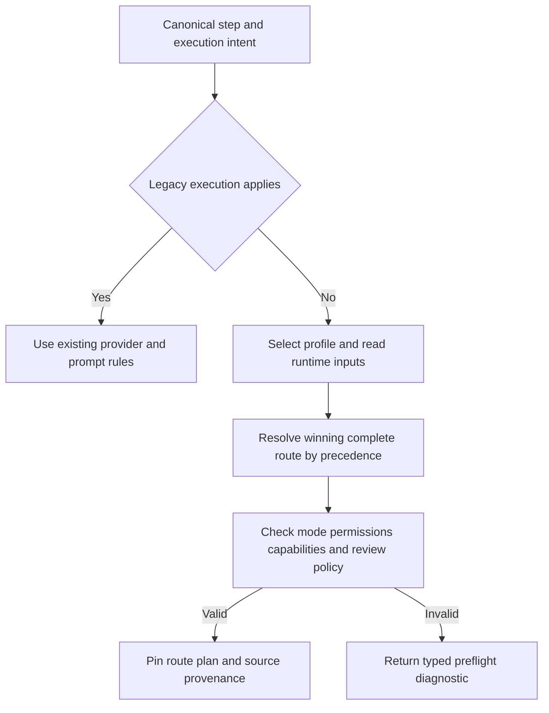
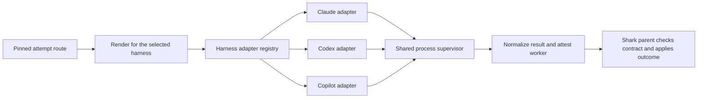
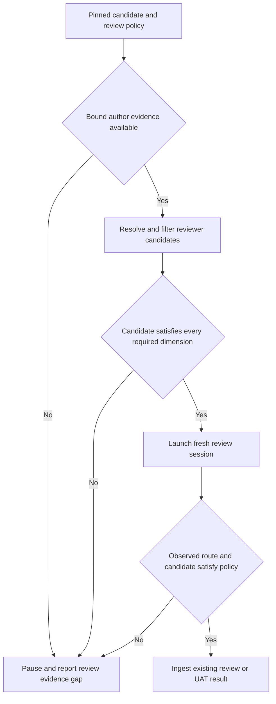
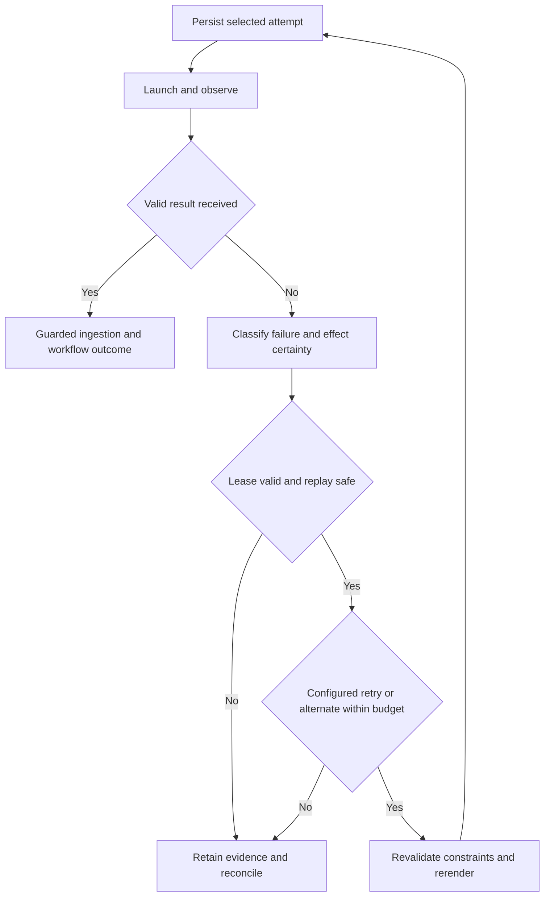

# Proposed technical architecture

## Boundaries

E35 resolves an outcome into a next status. The execution resolver selects a route for the current step before rendering its prompt. The adapter executes the selected attempt and reports evidence. The owner of the existing Shark claim validates results and controls transitions. Use one Go resolver from the core runner, keyed Rider assignments and a benchmark preflight/export command.

An execution route identifies the **harness** (CLI and mode), **provider** (serving backend and credential realm) and **model** (selector and canonical model identity). A model's publisher is separate catalog metadata. For example, a GitHub-managed Copilot route can serve an Anthropic model. Canonical model identity must recognize that same model across providers when evidence supports equivalence. Alias equality, version equivalence and provider independence require evidence.

## Workflow and profile contracts

Examples use YAML field paths to match Shark's canonical mapping syntax. Model IDs are placeholders to replace with qualified values.

| Field | Type and meaning | Example |
|---|---|---|
| `steps.<step>.complexity` | Optional execution intent on `spawn_agent`. Enum `low`, `medium`, `high`. | `discovery.complexity = medium`, `development.complexity = high`, `documentation.complexity = low` within the step map |
| `steps.<step>.execution_override` | Optional named route reference for a deliberate exception. | `steps.development.execution_override = regulated-dev` |
| `steps.<review-step>.review` | Optional policy on an existing review step. Includes Boolean `independent`, enum `complexity` and list `require_different` drawn from `model`, `provider`, `harness`. Requires an author source describing artifact kind and producer step, or an explicit contributor set for aggregate review. | `steps.code_review.review.independent = true`, `review.complexity = high`, `review.require_different = [model, provider]`, `review.author_source = development` |
| `steps.<step>.outcomes` | Existing E35 outcome mapping. | `steps.code_review.outcomes.pass = qa` |
| `routing_config`, `routing_profile` | Optional project config keys pointing to a versioned YAML document and a profile ID. Use an analogous user config for global defaults. | `routing_config = shark-data/routing.yaml`, `routing_profile = balanced` |

A review declaration on a worker step does not create a synthetic transition. The workflow declares the reviewer step and predecessor/source explicitly. Review complexity supplies that review step's intent. If both step and review complexity are present they must agree. Non-agent actions reject execution and review declarations. Phase, size, persona, `capability_profile` and legacy `model_tier` carry no implicit complexity. Define low as bounded and routine, medium as work requiring judgment across several inputs, and high as design, cross-cutting implementation or demanding verification. These values neither grant permissions nor prescribe reasoning tokens.

Example workflow excerpts in YAML flow notation. Retain the existing prompts, result contracts and full outcome maps on these steps.

- `steps: {discovery: {action: spawn_agent, agent: researcher, complexity: medium}, development: {action: spawn_agent, agent: developer, complexity: high}, documentation: {action: spawn_agent, agent: developer, complexity: low}}`
- `steps: {code_review: {action: spawn_agent, agent: tech-lead, review: {independent: true, complexity: high, require_different: [model, provider], author_source: development}}}`

| Profile document field | Shape | Example assignments |
|---|---|---|
| `schema_version` | Required integer major version. Strict YAML with duplicate and unknown field rejection. | `1` |
| `harnesses.<id>` | Trusted descriptor. Adapter ID, executable, supported modes/profiles, typed permissions, auth reference and version constraints. Adapter owns flag mapping, output and session semantics. | `harnesses.codex.adapter = codex-cli`, `executable = codex`, `modes = [exec]` |
| `routes.<id>` | Required harness, provider binding, model, mode. Optional effort, permission-policy reference, timeout and fallback policy. Provider binding contains canonical provider ID and approved auth/backend configuration reference. | `fast = codex / openai / <qualified-fast-model> / exec / low`, `standard = claude / anthropic / <qualified-standard-model> / print / medium`, `deep = codex / openai / <qualified-deep-model> / exec / high` |
| `profiles.<id>.complexity` | Map of complexity to named route. Every enabled profile must resolve all three levels across its declared layers. | `low = fast`, `medium = standard`, `high = deep` |
| `profiles.<id>.workflows.<workflow-id>` | Optional workflow-wide complexity mapping and `steps.<canonical-step>` route pins keyed by stable workflow ID. Profile selector uses the canonical bundle-relative workflow path for v1, including entity variant. | `workflows.workflow/feature.yaml.steps.code_review = independent-deep` |
| `profiles.<id>.review_candidates.<complexity>` | Ordered list of named complete routes. First eligible candidate wins after policy checks. | `high = [independent-deep, independent-alternate]` |
| `fallbacks.<id>` | Ordered alternate route IDs, triggering failure classes, same-route retry count, capped backoff, per-attempt and overall budget. Default is zero retries and zero alternates. | `launch-unavailable` allows one alternate for `executable_unavailable` |
| `harness_constraint` | Optional filter at the profile/run level. Harness-specific tables are ordinary named profiles with this filter. | `codex-only` selects a profile whose routes and alternates all use Codex |

`effort` is a separate optional normalized enum with `none`, `minimal`, `low`, `medium`, `high`, `xhigh`, `max` subject to verified provider/model/mode mappings. Explicit `none` differs from an omitted effort. An omitted effort lets the selected CLI use its policy/default, recorded as such. Benchmarks pin the concrete default when known and record a gap otherwise. Permission profile and execution mode are fixed per attempt after validation. Relative source identifiers are normalized by the bundle resolver, and duplicate stage identities are a validation error.

For example, `profiles: {balanced: {complexity: {low: fast, medium: standard, high: deep}, review_candidates: {high: [independent-deep, independent-alternate]}}}` references separately defined routes. A route entry can read `deep: {harness: codex, provider: openai, model: "<qualified-deep-model>", mode: exec, effort: high}`. Resolve `openai` through the descriptor's approved provider binding. A profile can point to a different route for `high` while the workflow retains the same declaration.

## Precedence and resolution

Highest precedence first. Administrative capability and permission limits apply after every selection, including runtime overrides.

1. Explicit runtime route (`--execution-route`) or one complete runtime replacement (`--execution-harness`, `--execution-provider`, `--execution-model`, optional `--execution-effort`). Reject conflicting flags. A standalone effort modifier may override the winning route's effort after validation.
2. Step `execution_override`, or legacy step `provider`/`model`/explicit `effort` interpreted as an override during opt-in migration.
3. Selected profile's workflow-and-step assignment.
4. Selected profile's workflow complexity mapping.
5. Selected profile's project complexity mapping.
6. Global complexity defaults when the project profile allows inheritance.
7. Existing legacy dispatch when the step has no complexity, no named pin, no enabled profile step assignment and no explicit execution override. Existing flags and flags derived from claims remain prompt metadata on this path.

Profile ID precedence is explicit run selection, including benchmark selection, then project default, then global default. The benchmark wrapper rejects competing runtime control for frozen runs. Profile overlays replace route references atomically at their scopes. Runtime harness/provider changes require an entire replacement, with effort either supplied or omitted. Never inherit an incompatible model or effort from a lower scope. Conflicting legacy fields and `execution_override` are a validation error. Legacy partial pins in opted-in workflows require an unambiguous legacy-compatible binding and a validated concrete model. When the original step relies on a harness default, pin the verified default explicitly before strict admission or retain the legacy path. A complexity-declaring step with an unresolved route fails preflight. In a benchmark, convert legacy pins to equivalent profile step assignments at the migration boundary so ordinary benchmark profile selection can vary them without weakening production precedence.

Independent review uses the same precedence to select its base route. Treat intentional runtime and workflow step pins as hard constraints. If a pinned review route is ineligible, pause with a configuration diagnostic. For a profile-derived selection, test the preferred route, then eligible review candidates. Reapply the policy to every fallback. Use one pinned configuration and capability snapshot per run, including cascade children. Apply changes at the next run boundary.

## Interfaces and adapter registry

| Contract | Input and result | Caller and ownership |
|---|---|---|
| `ResolveExecution` | Immutable routing inputs, canonical step/action, requested complexity, required mode/output/permissions, author references if applicable and pinned capability evidence. Returns ordered candidate plan, source for each selected value, skipped overrides, profile and config digests, or typed diagnostic. | Pure routing service with injected snapshots and no launch or persistence. Shared by run, next/export and E40. |
| `Capabilities` | Harness binding, executable/version, execution mode and account scope. Returns bounded support data, provenance, expiry and separate compatibility/auth observations. | Harness adapter. May consult a cached snapshot or explicit check. |
| `PrepareAttempt` | Validated route decision, rendering inputs, workspace and operation/result requirements. Returns a structured executable, argv, stdin, cwd, approved environment references, expected parser and timeout. | Registry resolves adapter by harness ID. Adapter enforces its permission and transport contract. |
| `ExecuteAttempt` | Prepared invocation and cancellation context. Returns bounded worker output, requested/selected/observed route evidence, metering, status and typed failure including phase and effect certainty. | Shared supervisor reuses current process capture, extended for bounded streaming and child cleanup. Preserve compatibility entry points during migration. |
| `RecordAttempt` and result admission | Versioned execution snapshot and attempt records bound to Shark run/session/entity/step. Successful payload includes stable operation ID and candidate/artifact digest for guarded ingestion. | Runner for local execution, parent for managed Rider/E40. The adapter cannot claim, advance or release. |

Use trusted YAML for binding an executable, selected mode, approved environment references, working-directory policy, timeout and capabilities. Provider selection is adapter-owned, with a qualified provider setting or an asserted fixed backend and readback. Prefer stdin and structured argv, with typed model/effort substitutions as single arguments and no shell evaluation. Use an approved executable path or safe PATH resolution. Reject invalid argv, unmanaged launch-time overrides and requests that would widen permissions. Disallow untrusted workflow or benchmark config from registering arbitrary executables, arguments, env values or weakening policy. Allocate cwd from the parent-approved project/worktree root, and enforce isolation across filesystem, subprocesses and network at the required level. Run read-only reviewers against immutable inputs. Separate worker privileges from parent state and credentials.

For keyed execution, expose the route-aware assignment through a versioned get/preview contract. The parent verifies the consumer supports the required adapter mode and attestation before claim when possible. Bind the chosen decision to the claimed step and recheck it at launch. Render one prompt per authorized attempt through Shark and retain its digest. Rider and E40 forward those exact bytes on that attempt. A fallback that needs a different harness render obtains a new keyed attempt from Shark.

| Adapter | Launch and effort | Output, permission and session contract |
|---|---|---|
| Claude Code | Print mode, model selector and `--effort` when supported by the binding. | Normalize structured/text transport while retaining the legacy bug gate transport. Enforce tool denies and selects via qualified policies. Same-harness continuation is optional and requires exact session binding. [CLI reference](https://code.claude.com/docs/en/cli-reference) |
| Codex CLI | Exec mode, explicit model and provider config when required, and typed `model_reasoning_effort`. | Normalize final output and bounded events. Use a qualified sandbox and approval mode for new routes. Reuse the B077 correlated thread/rollout evidence pattern when applicable. Native Codex host workers require a separate mode contract. [App server](https://learn.chatgpt.com/docs/app-server), [Rider contract](../../../skills/shark-rider/context/host-adapter-contract.md) |
| GitHub Copilot CLI | Non-interactive prompt, explicit model and model-qualified `--reasoning-effort`. Initial backend is GitHub-managed. | Normalize JSONL terminal output and worker-correlated metadata. Use least-privilege tested tool policy, based on deployment requirements. Resume is a distinct optional application capability. [Command reference](https://docs.github.com/en/copilot/reference/copilot-cli-reference/cli-command-reference), [programmatic reference](https://docs.github.com/en/copilot/reference/copilot-cli-reference/cli-programmatic-reference) |

Explicit unsupported effort fails preflight as `unsupported_effort`. An allowed fallback may provide a different explicit effort and must record it as a different decision. A fresh session is the default for every new attempt. Future same-harness session continuation needs persisted session identity, compatible mode, matching route/config/candidate and authorization. Cross-harness recovery uses a fresh session against validated artifacts.

## Independent review and admission

Resolve the author from the admitted producer attempt for the exact plan/artifact digest or candidate commit and scope. A scalar `author_source` names a producer step on the same entity and uses the gate's declared candidate artifact kind. Use the expanded mapping to identify a different artifact kind or contributing entities. A commit user or claimed route alone supplies no worker identity evidence. For an aggregate candidate, require the declared dimensions against every contributing producer in the configured source set and fail closed on missing provenance. Keep the binding when the author uses fallback. Review always executes as a fresh session against the pinned candidate. `independent: true` defaults to different canonical model. A nonempty `require_different` list is conjunctive and defines the required dimensions. Harness-only separation remains available as an explicit weaker policy.

Preflight verifies the selected review route's eligibility using authoritative model/provider mappings. Admission rechecks observed worker identity against the selected route and author, candidate scope, policy and claim. Where a dimension cannot be observed directly, permit only an adapter-proven fixed binding with evidence. Unknown and mismatched evidence pause strict gates. Manual review can proceed through existing authorized operator mechanisms with its own explicit admission record and reason. A harness or model failure does not silently reduce the required dimensions.

## Failure policy and durable execution

| Failure class | Default handling | When fallback or retry may proceed |
|---|---|---|
| Missing executable, unsupported model/provider binding or effort | Reject before starting the worker. | A configured alternate explicitly permits this class and can satisfy the same policy. |
| Provider unavailable or rate limited | Distinguish pre-execution rejection, definitive read-only failure and unknown execution state. Honor retry hint within total deadline. | Same-route retry or next alternate only with evidence of no effects or verified replay safety. |
| Authentication or entitlement failure | Pause for operator action. Never change credentials automatically. | A separately authorized binding may be selected only for an explicitly configured preflight auth rejection. |
| Timeout, process crash, model execution error | Stop the process tree and await termination and classify any possible writes or transition attempts. | Verified no-effects failures or certified read-only replay can use a configured retry/fallback. Ambiguous mutations require reconciliation and operator recovery. |
| Invalid output, identity mismatch, lease loss, cancellation, candidate drift | Pause or stop with typed diagnostic. Keep evidence and fence the attempt. | No automatic retry in v1. Ingest errors use existing gate reconciliation where eligible. |
| Sandbox, tool policy or operator denial | Stop and report the denial. | The denial applies to every fallback, including Rider inline. |
| Valid worker outcome such as `fail` or `blocked` | Apply normal E35 handling and existing admission checks. | Fallback does not reinterpret workflow outcomes. |

Bound launch attempts with a monotonic deadline and maximum attempts. Use deterministic configured ordering, bounded backoff and provider retry hints within the budget. Reject unknown references, duplicate targets, cycles and conflicts. Expand only the selected primary's fallback list in v1. Record alternate eligibility decisions. A hard override limits fallbacks to that route's explicitly configured policy and administrative authorization. A fallback cannot reuse a failed session or transfer credentials across bindings.

Persist a route-plan snapshot and per-attempt journal before launch. Use stable operation and attempt IDs and atomic compare-and-set writes tied to the parent lease. Record planned, starting, launched, stopped or result received, result admitted and terminal state. A crash between process launch and writing its identity leaves an uncertain attempt. Recover by checking correlated process/workspace and sidecar state. Allow redispatch only with durable no-effects evidence or certified replay safety. Block stale workers from admissions. Recheck lease, status, candidate and expected configuration before each launch and ingestion. Reconcile admitted or applied results by operation ID using existing gate guarantees before considering another attempt. Older gate sidecars stay readable, with their original identifiers and explicit unknown execution provenance. Always stop heartbeat and release or hand off through the existing parent path.

### Rider inline fallback

After Rider exhausts eligible external harnesses because none are available or every attempt ends in a fallback-eligible execution failure, it tries the keyed step once in the current host session. This is the final Rider skill fallback. Use `execution_mode: inline` in the attempt record and capture any verifiable host/model identity. Record unavailable identity explicitly. Core `shark run` and controlled E40 runs use their own declared execution modes.

Before going inline, Rider must confirm the previous worker is retired or never started, replay is safe, the assignment and lease are valid, and time and attempt budget remain. The inline attempt must satisfy the step's route constraints, permission and isolation requirements, and any review independence or fresh-session requirement. If the current host cannot enforce or attest a required boundary, report the blocker. In particular, the current author session cannot satisfy a fresh independent review. Keep policy denials and valid workflow outcomes terminal for the current attempt path.

Get a keyed assignment rendered for the inline host and use Shark's prompt verbatim. Record the reason for the switch and the inline result as parent-observed evidence. Keep work and lifecycle control separate within the skill. Rider applies the same result contract and admission checks, records the outcome once, and releases through the existing lease path. Pause with an actionable diagnostic if the inline attempt is ineligible or fails.

## Validation and evidence

`shark routing check` validates strict schema, complete effective complexity coverage, workflow selectors, adapter bindings, fallback graph, permissions and statically feasible review candidate sets. An offline snapshot mode checks compatibility for a pinned catalog. A local probe mode checks binary, version and required credential references and queries supported discovery interfaces when enabled. Initialize a local executable/version inventory during `shark admin init` when missing, or lazily on the first routing lookup; `shark admin harness refresh` forces a new local probe. Replace the snapshot atomically after a successful refresh and preserve the prior snapshot as stale on failure. The inventory is advisory: launch-time checks still verify the selected executable, compatibility, entitlement and current availability. An authenticated inference canary is a separate explicit operation with a budget. Emit stable machine-readable codes and redacted provenance. `routing explain` exposes the same resolver's ordered decision and optional frozen plan export for benchmark consumers. Use exact bindings in discovery caches keyed by executable/version, provider/binding, account scope, mode and relevant configuration digest. Expire or refresh on drift. Preserve unknown capability/entitlement as an explicit state. Strict gates and benchmark preflight require positive evidence for their declared contract.

Extend existing stage events and run evidence with versioned attempt records. Include workflow ID/digest, step and entity, run/operation/attempt/claim correlation, complexity, requested values, selected and observed harness/provider/model/effort, config source and relevant override decisions, catalog and adapter versions, fallback reason/order, outcome, author/reviewer candidate identity and satisfied dimensions. Store token usage, latency and cost with unit and provenance, allowing unavailable values. Use durable per-run artifacts for proof and bounded summary events for searchable telemetry. Keep prompts, credentials, raw environment and unredacted argv out of route logs. Restrict raw transcripts separately. Benchmark manifests include exact plan bytes or their content-addressed reference, frozen capability evidence and requested/selected/observed distinctions. Include only qualified attempts in comparisons under the existing eligibility contract.
